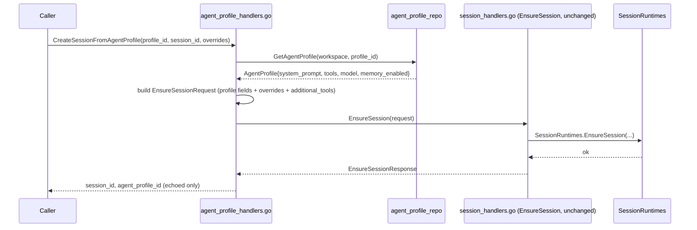

---
konstruct:
  docUuid: 46379e05-44b5-4158-a0fa-258903f4c705
  docKind: design
created: 2026-09-25T18:19:14.284Z
implemented: true
title: Agent profiles with per-agent session creation
assistantSessionId: 6fa597c1-2059-4762-b9dd-9a284d0b4f1a
---
# Agent profiles with per-agent session creation

## Goal

Add **agent profiles** as a first-class, named configuration bundle (name, description, default
system prompt, model/provider, memory-enabled flag, tool mapping, etc.) that a caller can pick
from and use to spin up a session — **without** turning `Session` into something that references
an agent. Sessions stay exactly what they are today: isolated, self-contained runtime entities
identified only by `session_id`, configured at `EnsureSession` time. An agent profile is a
*template* consumed once, at creation time, to produce the `EnsureSessionRequest` fields — it is
never stored on, or joined to, the session afterward.

## Why not "session.agent_id"

The obvious shortcut — add `agent_id` to the session row/proto and resolve profile fields lazily
on every turn — was explicitly rejected by the ask. Reasons this matters structurally, not just
as a preference:

- `internal/sessionmanager` and `EnsureSession` (`internal/server/session_handlers.go`) already
  treat a session as fully specified by the fields on `EnsureSessionRequest` — tools, system
  prompt sections, provider/model. Nothing downstream (agent loop, tool dispatch, history) knows
  about "agent" as a concept, and it doesn't need to.
- If a session held a live FK to a profile, editing the profile later would silently change the
  behavior of already-running sessions — a correctness and auditability problem (you can no
  longer tell, months later, exactly what config produced a given transcript).
- Keeping sessions profile-agnostic means the profile registry can be added, edited, and deleted
  freely with zero migration/back-compat coupling to `llmd_session*` tables.

So: **agent profile → resolved at creation time → materialized into the existing
`EnsureSessionRequest` shape → ordinary session from then on.**

## Data model: `AgentProfile` — two sources, one registry, no forced workspace scoping

**Revision (post-review):** an earlier draft made every profile a workspace-scoped DB row, mirroring
`llm_provider_repo.go`. That's wrong for the primary use case: a host app (e.g. konstructd) that
ships a fixed, code-defined set of agent profiles — same name, description, prompt, tools, model —
identical across every workspace, that it does *not* want mirrored into per-workspace DB rows.
Forcing DB storage would mean either duplicating those rows into every workspace (drift risk,
migration noise) or inventing a fake "global" workspace id as a hack.

This maps directly onto a real product split: **plugins** (e.g. konstructd) ship fixed,
code-defined agents that are identical everywhere they run → static tier. **Owlbert** lets a user
define arbitrary agents of their own, per workspace → dynamic tier. Both tiers are therefore
first-class, not "static now, dynamic later" — confirming the open question below in favor of
shipping both from the start.

Instead, profiles come from **two sources reconciled into one in-process registry**, the same
pattern `internal/toolexec/builtins.go`'s `RegisterBuiltins` already uses for tools: code registers
its builtins at startup, and the registry is what callers actually query — nothing about *tools*
requires a DB row just because *sessions* (which use tools) are persisted.

1. **Static profiles** — defined in Go, registered at process startup via a new
   `agentprofile.RegisterStatic(...)` call analogous to `RegisterBuiltins`. This is how konstructd
   supplies its fixed profile set: a slice of `AgentProfileDefinition` literals in konstructd's own
   init code, never touching `llmd`'s database. Static profiles are **not workspace-scoped** — they
   exist once per process and are visible to every workspace, because they're not workspace *data*,
   they're workspace-independent *configuration shipped with the binary*, exactly like the builtin
   tool set already is.
2. **Dynamic profiles** — optional, workspace-scoped, DB-backed (`llmd_agent_profiles` table +
   `agent_profile_repo.go`, same shape as before) for callers who *do* want to author/edit profiles
   at runtime through the CRUD RPCs below. This tier is additive and can genuinely be deferred to a
   later milestone if the only day-one need is static profiles — nothing in the creation RPC depends
   on it existing.

Both sources are read through one interface, `agentprofile.Resolver`:

```go
type Resolver interface {
    // Get resolves id -> profile. Static registrations are checked first; if none matches,
    // falls through to the workspace-scoped DB repo (only reachable when workspaceID != "").
    Get(ctx context.Context, workspaceID, profileID string) (*AgentProfile, error)
    List(ctx context.Context, workspaceID string) ([]*AgentProfile, error) // static ++ dynamic, static first
}
```

Static-vs-dynamic precedence and id-collision handling: static profile ids are namespaced by the
registering module at registration time (e.g. `konstructd:coder`), so they can never collide with
a generated dynamic-profile uuid. `List` simply concatenates both slices; `Get` checks the static
map (an in-memory `map[string]AgentProfileDefinition` built once at startup — "reconciled at
startup" in the sense that duplicate-id registration is a startup-time fatal error, not a runtime
merge) before falling through to the repo.

### Shape (same fields regardless of source)

| Field | Type | Notes |
|---|---|---|
| `id` | string | uuid for dynamic; caller-chosen namespaced string (e.g. `konstructd:coder`) for static |
| `workspace_id` | string, nullable | **absent/empty for static profiles**; set for dynamic rows |
| `name` | string | unique within its source+scope |
| `description` | string | optional, free text |
| `system_prompt_sections` | list | reuses `SystemPromptSection` shape already on `EnsureSessionRequest`; for dynamic rows, persisted via `internal/store/system_prompt_sections_json.go` (extend, don't fork); for static, just a Go literal |
| `llm_provider_id` | string, nullable | default provider; caller can still override at creation |
| `default_model` | string, nullable | default model; caller can still override |
| `memory_enabled` | bool | gates the assistant-memory hook (`internal/llm/common/memctx`) for sessions created from this profile |
| `tool_mapping` | list | list of `{tool_name, enabled, override_config?}` — see below |
| `created_at` / `updated_at` | timestamp | dynamic rows only; static profiles report the binary's build time or are omitted |

`tool_mapping` deliberately mirrors `ToolDefinition` / the existing `RegisterSessionTool` /
`toolmerge` shape (`internal/server/session_handlers.go`, `internal/toolmerge`) rather than
inventing a new schema: a profile's tool list is materialized into the same
`initialTools []ToolDefinition` that `EnsureSessionRequest` already accepts. This means the merge
logic in `internal/toolmerge` needs no changes — it already reconciles an incoming tool list
against built-ins/readonly rules regardless of where that list came from.

No new relationship exists between the profile registry (either source) and `llmd_sessions` — a
profile is read exactly once, by the new creation RPC, and never joined against session tables.
Dynamic (DB) profiles are workspace-scoped exactly like everything else in this server
(`internal/server/workspace_scope.go` / `dbWorkspaceID`); static profiles simply skip that check.

## gRPC API

Two additive surfaces on the existing `llm.v1` service (`llmv1/llm.proto` — same file that
declares `EnsureSessionRequest`); nothing existing changes shape.

### 1. Agent profile CRUD (management plane — dynamic profiles only)

`Create`/`Update`/`Delete` only ever touch the dynamic (DB-backed) tier; calling them with a
static profile's namespaced id fails with `InvalidArgument` ("profile is statically registered
and read-only"). `Get`/`List` transparently merge both tiers via the `Resolver`, so callers never
need to know or care which tier a given profile came from.

```
rpc CreateAgentProfile(CreateAgentProfileRequest) returns (AgentProfile);
rpc UpdateAgentProfile(UpdateAgentProfileRequest) returns (AgentProfile);
rpc DeleteAgentProfile(DeleteAgentProfileRequest) returns (DeleteAgentProfileResponse);
rpc GetAgentProfile(GetAgentProfileRequest) returns (AgentProfile);       // static ++ dynamic
rpc ListAgentProfiles(ListAgentProfilesRequest) returns (ListAgentProfilesResponse); // static ++ dynamic

message AgentProfile {
  string id = 1;
  string name = 2;
  string description = 3;
  repeated SystemPromptSection system_prompt_sections = 4;
  optional string llm_provider_id = 5;
  optional string default_model = 6;
  bool memory_enabled = 7; // reserved, always false for now — see "Memory" below
  repeated ToolMapping tool_mapping = 8;
  string created_at = 9;
  string updated_at = 10;
}

// v1: pure allowlist, no per-tool config. tool_name must match a name the
// running process's builtin/registered tool set actually knows; unknown names
// are rejected at profile create/update time, not silently dropped at session
// creation time.
message ToolMapping {
  string tool_name = 1;
  bool enabled = 2;
}
```

Handlers live in a new `internal/server/agent_profile_handlers.go`, following the exact shape of
`session_handlers.go` (workspace-scope guard, `requireSessionID`-style validation helper for
name/id, thin pass-through to the store repo). No new package is needed beyond the store repo —
this is CRUD, not runtime.

### 2. Session creation from a profile (the actual ask)

```
rpc CreateSessionFromAgentProfile(CreateSessionFromAgentProfileRequest)
    returns (CreateSessionFromAgentProfileResponse);

message CreateSessionFromAgentProfileRequest {
  string agent_profile_id = 1;   // or agent_profile_name, see open question below
  string session_id = 2;         // caller still assigns/owns the session id, same as EnsureSession
  optional string display_name = 3;

  // Optional overrides — same override-the-default pattern EnsureSession already has for
  // llm_provider_id / default_model. Anything set here wins over the profile's value.
  optional string llm_provider_id_override = 4;
  optional string default_model_override = 5;
  repeated ToolDefinition additional_tools = 6; // merged on top of the profile's tool_mapping
}

message CreateSessionFromAgentProfileResponse {
  string session_id = 1;
  string agent_profile_id = 2; // echoed for the caller's own bookkeeping — NOT persisted server-side
}
```

Handler implementation (`internal/server/agent_profile_handlers.go`):

1. Look up the profile via `agentprofile.Resolver.Get` (checks static registrations first, then
   falls through to the workspace-scoped repo — a request for a static profile id works
   identically whether or not the caller's workspace has ever written a dynamic profile).
2. Resolve `tool_mapping` → `[]ToolDefinition` (enabled entries only), merge `additional_tools`.
3. Build an `*llmv1.EnsureSessionRequest` from the profile's `system_prompt_sections`,
   `llm_provider_id`/`default_model` (or their overrides), and the resolved tool list.
4. Call `s.EnsureSession(ctx, req)` — **the existing handler, unmodified** — so every invariant
   session creation already has (workspace validation, `validateAgentLlmBinding`,
   `SessionRuntimes.EnsureSession`) applies unchanged.
5. `memory_enabled` is accepted on the schema (so profile authors can set intent now) but is
   **inert in v1** — no wiring to `internal/llm/common/memctx` yet. See "Memory" below.

The result: `CreateSessionFromAgentProfile` is a **convenience composition RPC**, not a new
runtime concept. It calls `EnsureSession` internally; a session created this way is
indistinguishable, in the store, from one created by hand-assembling the same
`EnsureSessionRequest`. That's the point — it keeps "session" a single, uniform entity.

## Memory

`memory_enabled` exists on the schema now so profile shape doesn't need a breaking change later,
but it's **not wired to anything in v1**. `internal/llm/common/memctx` needs cleanup before it's
solid enough to expose as a per-agent toggle (per user decision, out of scope here). Consequence:
`CreateSessionFromAgentProfile` accepts and stores the field, but the handler does not act on it —
sessions created from any profile behave exactly as sessions do today, memory-wise. Flipping this
on later is additive: wire the flag to whatever the eventual memory-hook registration point turns
out to be, no schema or RPC change needed.

## Open questions (resolved)

- **Lookup key**: `id` is the primary field, as drafted. Resolved — namespacing collisions are the
  caller's job: Owlbert namespaces its own dynamic ids as `pluginId/agent-id` so plugin-defined and
  user-defined ids can't collide, on top of static ids already being namespaced by the registering
  module (`konstructd:coder`). No `name`-based lookup needed for v1.
- **Tool mapping granularity**: resolved — v1 `ToolMapping` is a pure `{tool_name, enabled}`
  allowlist, no per-tool config override. `override_config_json` dropped from the message (see
  updated `ToolMapping` above); can be added as a new optional field later without breaking
  existing profiles.
- **Memory-enabled wiring**: resolved — leave `memory_enabled` inert in v1 (see "Memory" above).

## Still open

- ~~**Static-registration seam**~~ Resolved: option (a) — `llmd` exposes
  `agentprofile.RegisterStatic(...)` and konstructd (and any other host process) calls it during
  its own startup wiring, same shape as how it already assembles `RegisterBuiltins` + extra tool
  registrars. No constructor-arg plumbing through the top-level server struct.
- **Programmatic registration for "core" static profiles**: today static registration is
  Go-literal-only, callable by any host process at startup. A later need — explicitly deferred by
  request, not a v1 blocker — is a way to register *llmd's own* core profiles programmatically
  (e.g. from config rather than a recompiled literal) so they don't require a code change to add.
  Noted here so it isn't lost, not designed further right now.

## Flow



Note the session row created by `SessionRuntimes` has no column referencing the profile — the
arrow back to the caller is informational, not a persisted relationship.

## Impact summary

- **New**: `internal/agentprofile` package (`Resolver`, `AgentProfileDefinition`, `RegisterStatic`,
  the static in-memory map); `llmd_agent_profiles` table + `agent_profile_repo.go` (dynamic tier —
  ships day one, backs Owlbert's user-defined agents); `agent_profile_handlers.go`; proto additions
  (`AgentProfile`, `ToolMapping`, 5 CRUD RPCs, 1 composition RPC).
- **Unchanged**: `EnsureSessionRequest`/`EnsureSessionResponse` shape, `SessionRuntimes`,
  `internal/toolmerge`, `internal/sessionmanager`, session store schema, agent loop
  (`internal/server/agent_loop_test.go` describes a loop that only ever sees a fully-resolved
  session — it stays oblivious to profiles entirely).
- **No per-workspace duplication for plugin-shipped agents**: static profiles (konstructd and other
  plugins' fixed sets) live once per process, registered the same way builtin tools are
  (`internal/toolexec/builtins.go` `RegisterBuiltins`), and are visible from every workspace without
  a single DB row — while Owlbert's user-authored agents get full per-workspace CRUD via the
  dynamic tier, exactly where that model is the right one.
- **Client packages** (`packages/client`, `packages/client-web`): regenerate from proto; add a thin
  `agentProfiles.ts` alongside the existing `sessionAttachments.ts` pattern for the new RPCs.