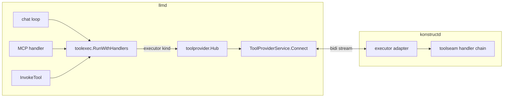
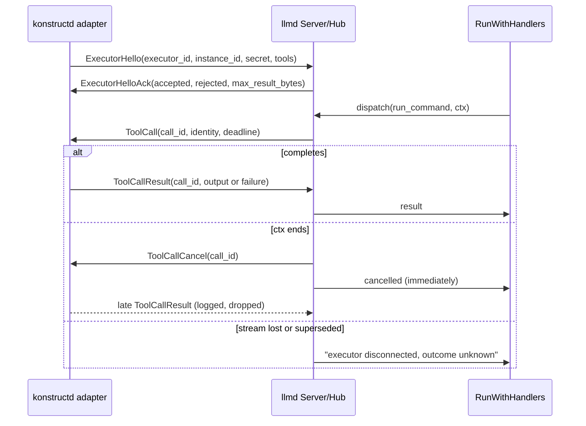

---
konstruct:
  docUuid: d600bcff-5984-42e5-b1c5-b23208c29eec
  docKind: design
created: 2026-10-04T02:21:08.865Z
implemented: true
title: Executor tool stream protocol
assistantSessionId: ca29e998-0ba5-4132-ab74-fa08a2ae885c
---
# Executor tool stream protocol

## Goal

Let a backend process (konstructd first, remote tool hosts later) serve tools to llmd over one long-lived bidi stream, so tool code no longer has to be linked into llmd's process.

## Where we start

`ToolProviderService.Connect` (`internal/toolprovider/server.go`) already does most of the transport work:

- The first frame must be `ToolProviderHello`. It is checked against `LLMD_TOOL_PROVIDER_SHARED_SECRET`, and registration is refused if that variable is unset.
- The tenant scope comes from the stream context (`serverutil.ScopeFromContext`), so every provider today is **bound to a scope**.
- `Hub.Register(sc, stream)` attaches the stream. After that, the server loop only handles `Result` frames, which go to `Hub.DeliverResult(execution_id, …)`.
- It has no per-stream record of pending calls. When a stream drops, its in-flight calls wait until they time out.

This design extends that stream. It does not add a new service. Inline registration is unchanged, and tools move over one at a time.

## Component boundaries



| Component | Owns | Does not own |
|---|---|---|
| `toolexec.RunWithHandlers` | Read-only check, picking the executor case, adding the deadline | Stream state |
| `toolprovider.Hub` | Executor registry, name ownership, pending-call table, cancel and size cap | Tool semantics |
| `toolprovider.Server` | Handshake, auth, frame demux | Dispatch decisions |
| konstructd adapter | Hello built from builtin tables, `ToolCall` → `toolseam.Invocation`, `call_id → cancel` map | Checkout resolution policy (delegated to existing wrappers) |

## Wire additions (`proto/llmv1/llm.proto`)

Every change adds to existing messages: new oneof arms and new messages. Field numbers that are already in use stay as they are.

```proto
// New execution kind on ToolDefinition's execution oneof.
message ToolExecutionExecutor {
  string executor_id = 1;
  uint32 max_duration_seconds = 2; // 0 => llmd default
}

// provider -> llmd, first frame (alternative to ToolProviderHello)
message ExecutorHello {
  string executor_id = 1;   // stable logical owner, e.g. "konstructd"
  string instance_id = 2;   // per-process; new instance supersedes old
  string shared_secret = 3;
  repeated ToolDefinition tools = 4; // execution = ToolExecutionExecutor{executor_id}
}

// llmd -> provider
message ExecutorHelloAck {
  repeated string accepted = 1;
  repeated RejectedTool rejected = 2;
  uint64 max_result_bytes = 3;
}
message RejectedTool { string name = 1; string reason = 2; }

enum ToolCallOrigin {
  TOOL_CALL_ORIGIN_UNSPECIFIED = 0;
  TOOL_CALL_ORIGIN_CHAT_LOOP = 1;
  TOOL_CALL_ORIGIN_MCP = 2;
  TOOL_CALL_ORIGIN_INVOKE_TOOL = 3;
}

// llmd -> provider
message ToolCall {
  string call_id = 1;        // llmd-minted, unique per stream; correlation key
  string tool_call_id = 2;   // model-facing id, informational
  string tool_name = 3;
  string arguments_json = 4;
  string tenant_id = 5;
  string scope_id = 6;
  string session_id = 7;
  string turn_id = 8;
  bool read_only = 9;
  ToolCallOrigin origin = 10;
  google.protobuf.Timestamp deadline = 11;
}

// llmd -> provider
message ToolCallCancel { string call_id = 1; string reason = 2; }

// provider -> llmd
message ToolCallResult {
  string call_id = 1;
  oneof outcome {
    ToolCallOutput output = 2;
    ToolCallFailure failure = 3;
  }
}
message ToolCallOutput {
  string content = 1;
  string dedup_key = 2;
  repeated ToolAttachment attachments = 3; // reuse existing attachment type
}
message ToolCallFailure { string message = 1; }
```

New arms on the existing frames:

- `ToolProviderToServer.frame`: `executor_hello`, `tool_call_result`
- `ToolServerToProvider.frame`: `executor_hello_ack`, `tool_call`, `tool_call_cancel`

`agent_id` is left off the wire on purpose. It looks like a session id under another name, and `session_id` already covers it.

**Why `call_id` instead of the existing `execution_id`:** legacy results are keyed by `(execution_id, tool_id)` and come with `is_error`. A separate key and a typed `outcome` keep the two paths from sharing a correlation table by accident, and they make "error from the handler" a value of its own type, distinct from a transport failure (rule 9).

## Lifecycle



## Rules and where each is enforced

| # | Rule | Enforced in |
|---|---|---|
| 1 | Declared tools are **tenant-scoped**. They are visible only to sessions in the tenant that registered them, and sessions in that tenant pick them through their profile | The Hub registers them under the stream's `tenant_id`. Tool listing and `toolmerge` see executor tools only when the session's tenant matches; other tenants never see the name |
| 2 | One dispatch point | New `ToolExecutionExecutor` case in `toolexec.RunWithHandlers`. Chat loop, MCP and `InvokeTool` already go through it |
| 3 | Identity only: llmd sends tenant/scope/session, the executor resolves the checkout | `ToolCall` carries no paths |
| 4 | One owner per name **per tenant**. The ack rejects a name that is held inline (a global name) or by another executor in the same tenant. Two tenants may each register the same name. Same `(tenant_id, executor_id)` + new `instance_id` supersedes | Hub, during hello handling, under the registry lock |
| 5 | Fail fast when the executor isn't attached: return an immediate tool error naming the executor | Hub dispatch: the definition is registered but has no owner |
| 6 | At-most-once: on stream loss or supersede, fail every pending call with "executor disconnected, outcome unknown". No replay | Hub's per-stream pending table, drained on detach |
| 7 | Cancel without waiting: send `ToolCallCancel`, return at once, log and drop late results. No cancel-ack | Hub dispatch `select` on `ctx.Done()` |
| 8 | Long calls: llmd waits up to `max_duration_seconds`. Shorter timeouts are the executor's job | `RunWithHandlers` derives the deadline and puts it in `ToolCall.deadline` |
| 9 | Handler output and handler error both reach the model verbatim. Transport failures are written by llmd and never sent on the wire | `outcome` oneof; llmd owns the strings for disconnected, unattached, cancelled, timeout and oversize |
| 10 | Read-only stays in llmd: the mutation check runs before dispatch, using the declared classification | Existing check in `RunWithHandlers`, run before the executor case |
| 11 | Size cap: an oversized result becomes a failure that says so | Hub, on receive, compared with the advertised `max_result_bytes` |
| 12 | Turn cancel reaches every tool call from that turn, whatever its origin, as far as llmd can guarantee it (see *Turn cancellation* below) | `Hub.CancelTurn(tenantID, turnID)`, called from the turn-cancel path |

### Detach semantics

When a stream detaches, its tools stay **registered but ownerless**. They remain visible in profiles and tool lists, but calls fail fast (rule 5). This keeps the model's tool list stable across a konstructd restart, and reattaching only has to re-own the names. A detach logs at `Warn` with `executor_id`, `instance_id` and the number of pending calls failed, per the never-swallow rule.

### Turn cancellation

When a turn is cancelled, llmd doesn't rely on context propagation. The ctx of an MCP-origin call belongs to the CLI's request, not to llmd's turn. The turn-cancel path therefore calls `Hub.CancelTurn(tenantID, turnID)` directly.

**What llmd guarantees** (all of it inside llmd, so it can be tested):

1. **Every pending call of the turn gets a `ToolCallCancel`.** This uses the Hub's `(tenant_id, turn_id) → call_ids` index and covers every origin: chat loop, MCP and `InvokeTool`.
2. **Every waiter returns immediately** with "cancelled: turn cancelled". The model or the CLI sees a tool result instead of a call that hangs.
3. **No new calls for a cancelled turn.** The Hub keeps a short-lived tombstone for cancelled `(tenant_id, turn_id)` pairs, held at least as long as the longest `max_duration_seconds`. A dispatch that arrives afterwards, such as a CLI that kept going and issued another MCP call, fails fast and never reaches the executor.
4. **Late results are logged and dropped**, as in rule 7.
5. **Idempotent.** Cancelling a turn twice, or cancelling one whose calls already finished, does nothing.

**What llmd cannot guarantee, and the backstop for it:**

- *That the work actually stops.* That depends on the handler honouring its ctx. The executor contract says: cancelling `call_id` cancels the handler's ctx, and for `run_command` that kills the process group. A handler that ignores its ctx still stops at `deadline`, which is always finite.
- *That the cancel frame arrives.* If the stream is down, the call has already failed as disconnected under rule 6. At-most-once means it is never replayed.
- *Side effects that already happened.* A cancelled mutation can be partly done. The message says "outcome unknown" so the model doesn't assume it was rolled back.

Each `CancelTurn` logs at `Info` with the tenant, the turn, the number of calls cancelled and the number of tombstone rejections.

### Supersede race

The new hello takes the registry lock, swaps the owner to the new stream, and *then* drains the old stream's pending table. A call dispatched between those steps went to the old stream, so it fails as disconnected. That matches at-most-once and needs no special case.

## llmd work

1. **Proto + codegen.** Add the messages and oneof arms above. Provider-config sync rules don't apply because these aren't provider config messages, but `@llmd/client` / `@llmd/client-web` regenerate.
2. **Hub: pending table per stream.** `map[streamID]map[callID]chan outcome`. `unregister()` closes every pending channel with the disconnected outcome. The **legacy provider path** gets the same fix: today its calls just sit until timeout.
3. **Hub: executor registry, keyed by tenant.** `(tenant_id, executor_id) → {instance_id, stream, names}` plus `(tenant_id, name) → executor_id`. Dispatch looks up the call's tenant. A call whose tenant has no registration for the name never reaches any stream. Hello handling checks ownership against inline registrations and other executors, registers the accepted definitions, and sends the ack.
4. **Server.Connect.** Branch on the first frame: `hello` goes down the legacy path unchanged, `executor_hello` goes to the new path. Both share the secret check. Add a `tool_call_result` demux arm. Unknown frames after hello should log at `Debug`, not disappear silently.
5. **`RunWithHandlers` executor case.** Check read-only → compute the deadline from `max_duration_seconds` → `Hub.Call(ctx, def, invocation)`. On `ctx.Done()`, Hub sends the cancel and returns.
6. **Turn cancel.** Add a `(tenant_id, turn_id)` index on pending calls, `Hub.CancelTurn`, and a tombstone set with a TTL. Wire `CancelTurn` into the existing turn-cancel path.
7. **Tests.** Fake executor over bufconn: accept/reject in the ack, supersede drains pending calls, stream drop fails pending calls immediately, cancel returns without waiting for a result, late result is dropped, oversize becomes a failure, unattached fails fast. For turn cancel: a blocking MCP-origin call gets `ToolCallCancel` on the wire, a dispatch after the cancel is refused by the tombstone, and a second `CancelTurn` does nothing.

## konstructd work

One adapter package:

- Opens **one stream per tenant it serves**. Each stream carries that tenant's scope in its context, as client providers do today. On each, it sends `ExecutorHello` built from the existing builtin tables, **filtered to the tools being migrated** (starting with `run_command`).
- For each `ToolCall`: rebuild `toolseam.Invocation` (tenant, scope, session, turn, args), derive a ctx with the deadline, store `call_id → cancel`, and run the existing handler chain in a goroutine.
- On `ToolCallCancel`: look up the call and cancel it. Unknown ids are logged and ignored.
- Reconnect with backoff and a fresh `instance_id` for each process (not each reconnect), so a reconnect from the same process doesn't look like a supersede from a different instance.
- Logs any names rejected in the ack at `Warn`. A rejected name means that tool silently isn't migrated.

## Rollout

1. Land the proto, Hub and dispatch with no executor tools declared. No behaviour change, except that legacy pending calls now fail on disconnect.
2. konstructd declares `run_command` and drops its inline registration in the same change, so rule 4 doesn't reject the name.
3. Soak it, then move `task_started` / `phase_done`, then the rest of the builtins one at a time.

## Proof case

`run_command` is a long-running mutation that can only be cancelled through its context, and it sits behind three wrappers that read scope and session id. It exercises rules 3, 6, 7, 8 and 10 all at once. The runner-up is `task_started` / `phase_done`: they run checks inside the call and take no timeout argument.

## Out of scope for v1

Progress streaming, chunked results, concurrency limits, ping/pong. Keepalive comes from gRPC/HTTP2 for now.

## Decisions

There are no open questions left. Each item below was decided so that v1 stays correct whatever the external behaviour turns out to be.

- **CLI provider timeouts → handled the same way under either answer.** v1 makes no assumption about whether claude-code or cursor-cli enforce their own MCP tool-call timeout. If a CLI gives up first, its MCP request context ends. That reaches `RunWithHandlers` as `ctx.Done()`, rule 7 sends `ToolCallCancel`, and the executor stops the work. The worst case is a run that ends early, never an orphaned process. The effective cap is `min(CLI timeout, max_duration_seconds)`.
  - *Watching for it:* the Hub logs each cancel at `Info` with `origin`, elapsed time and `max_duration_seconds`. If MCP-origin cancels cluster at a fixed elapsed time, that's a CLI cap. Write it down per provider and, if needed, clamp `deadline` to it later. Neither step changes the protocol.

- **Turn cancel → tool cancel.** llmd cancels the turn's calls explicitly with `Hub.CancelTurn`, so it no longer matters whether cancelling the turn ends the call's context. It covers every origin, and the guarantees are listed under *Turn cancellation* (rule 12).

- **Tenant breadth → tenant-bound.** A tool belongs to the tenant whose stream registered it (rules 1 and 4). There is no all-tenants credential. The executor path uses the same `ScopeFromContext` check as client providers, and the stream's tenant is the only tenant it can serve. As a check in depth, the Hub also refuses to send a `ToolCall` whose `tenant_id` differs from the stream's tenant, and logs it at `Warn`. A konstructd that serves several tenants opens one stream per tenant.
  - *Follow-up:* that means N streams for N tenants. That's fine at konstructd's scale. If the tenant count grows, multiplexing is a v2 change and doesn't need a new trust model.