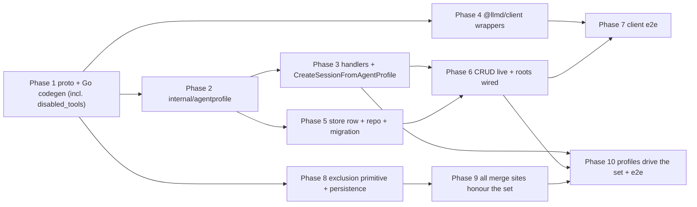

---
konstruct:
  docUuid: 15938052-a2d0-4f85-9691-5b6e2c3d6d7e
  docKind: plan
created: 2026-09-28T16:47:24.764Z
implemented: false
title: Agent profiles with per-agent session creation
summary: agentprofile registry (static + DB), 6 llm.v1 RPCs,
  CreateSessionFromAgentProfile over unchanged EnsureSession, soft per-session
  tool exclusion (disabled_tools), @llmd/client wrappers.
sourceDesign:
  name: agent-profiles-with-per-agent-session-creation.md
  docUuid: 46379e05-44b5-4158-a0fa-258903f4c705
  title: Agent profiles with per-agent session creation
assistantSessionId: eac6c291-2a97-44c7-bf06-115e87bf357c
---
# Agent profiles with per-agent session creation

## Summary

Add **agent profiles** — named config bundles (prompt sections, provider/model, tool allowlist, inert `memory_enabled`) — from two sources reconciled through one in-process `agentprofile.Resolver`: **static** profiles registered in Go at host startup (konstructd's fixed set, the same shape as `toolexec.RegisterBuiltins`), and **dynamic** workspace-scoped rows in a new `llmd_agent_profiles` table (Owlbert's user-authored agents). A new `CreateSessionFromAgentProfile` RPC reads a profile once, materializes an `*llmv1.EnsureSessionRequest`, and calls the **existing, unmodified** `LlmServer.EnsureSession` (`internal/server/session_handlers.go:18`). Sessions never reference a profile.

Milestone 3 (decided 2026-09-28) adds the one seam the design could not know it needed: a **soft per-session tool exclusion** (`EnsureSessionRequest.disabled_tools` → `SessionRow.DisabledToolsJSON` → `SessionRuntime.DisabledTools`) so a profile's `enabled=false` actually keeps a server-wide tool out of the session's model-facing list *by default* — while any explicit per-session registration (`additional_tools`, `RegisterSessionTool`) brings it back. It is a correctness/ownership fix, not a security boundary.

## Findings that adjust the design

These come from reading the code, not the design; the Blueprint Drafter should treat them as binding.

**F1 — `tool_mapping.enabled=false` has no runtime effect on server-registered tools today.** `LlmServer.mergedToolDefinitions` (`internal/server/server.go:484`) unconditionally merges `s.Tools.Snapshot()` (every server-wide tool, including everything a host registrar like graphtools/wstools installs) with the session's own `ma.Tools.Snapshot()` via `toolmerge.MergeDefinitions`. `EnsureSessionRequest.initial_tools` can only *add* per-session tools; there is no per-session exclusion anywhere in `sessionmanager.SessionRuntime` or `store.SessionRow`. `internal/mcpserver/server.go` repeats the same merge independently at three sites (lines 252, 377, 706). **Decision:** ship the exclusion seam as Milestone 3 with **soft semantics** — "excluded from this session unless explicitly added" — via a single pure function `toolmerge.MergeDefinitionsExcluding` that every merge site calls. Milestones 1–2 still validate `tool_mapping` names against `s.Tools.Snapshot()` and clone `enabled=true` entries into `initial_tools`; Phase 10 turns `enabled=false` into `disabled_tools`. Until Phase 10 lands, `enabled=false` is recorded but not enforced (same status as `memory_enabled`). This amends the design's "Unchanged" list for `EnsureSessionRequest` (one additive field) and `SessionRow` (one additive column); `EnsureSession`'s handler body is still untouched.

**F2 — `packages/client-web` does not exist any more.** `packages/client/src/index.ts` documents that it was folded into `@llmd/client` (one protobuf-es codegen via `packages/client/scripts/proto-gen.mjs`, `./node` and `./web` transports sharing `src/gen/llmv1/llm_pb.ts`). Only `packages/client` is touched. The provider-config sync rule in `.konstruct/rules` about `packages/client-web/src/index.ts` is stale for the same reason; nothing in this plan changes provider-config messages so it does not apply.

**F3 — Static registration must return errors, not panic, and must be test-isolatable.** `LlmServer` deliberately owns its `Handlers`/`Tools` per instance ("two independently constructed LlmServers never share registration", `server.go:63`). `RegisterStatic` is package-level per the design, so the package also exposes `agentprofile.NewRegistry()` for tests, and `RegisterStatic` writes into a package-level `agentprofile.Default` registry and returns an `error` on duplicate/invalid ids (hosts `Fatalf` — never swallow, per the Go error rule).

**F4 — Static profiles cannot validate tool names at registration time.** Tools are registered after `RegisterStatic` may run and per-`LlmServer`, so a static profile's `tool_mapping` is validated at `CreateSessionFromAgentProfile` time against `s.Tools.Snapshot()` and fails `InvalidArgument` (not silently dropped). Dynamic profiles are additionally validated at Create/Update, as the design says.

## Graph facts driving the phase split

- `internal/store` has **54 inbound files** (Go package-level edges; `traverse_graph precheck`, confidence medium). Milestone 1–2 store changes are **new files** plus one appended entry in `CoreModels` (`internal/store/migrate.go`, 10 direct inbound). Milestone 3 adds one column to `SessionRow` (`internal/store/models.go:43`) — additive, `AutoMigrate` adds it, no caller edits.
- `internal/server/session_handlers.go` has 4 inbound (`cmd/llmd/main.go`, `internal/mcpserver/server.go`, `llmdtest/inprocess.go`, one test). `EnsureSession` is **never edited**; the new handler file calls `s.EnsureSession` as a Go method. The only touch is a one-line swap in `ListSessionTools` (line 163) in Phase 9 so the management list matches what the model sees.
- `server.LlmServer{...}` is constructed at **14 sites** (`cmd/llmd/main.go:234`, `llmdtest/inprocess.go:115`, 12 test literals in `internal/mcpserver` and `internal/serve`). The new `AgentProfiles`/`AgentProfileRepo` fields are optional and nil-safe (lazy static-only fallback, mirroring `Sessions`/`sessionsOnce`), so only the two composition roots are edited and no test literal changes.
- `var _ llmv1.LlmServiceServer = (*LlmServer)(nil)` (`server.go:176`) plus the embedded `UnimplementedLlmServiceServer` means proto regen compiles before handlers exist — proto can land as its own phase.
- `internal/sessionmanager/session.go` has 6 inbound files and `manager.go` 12; Milestone 3 edits them additively (one field, one hydration line, one update branch) and changes no signatures.
- `internal/toolmerge` has 2 inbound files (`internal/server/server.go`, `internal/mcpserver/server.go`) — exactly the two packages that must adopt the new exclusion function, so the blast radius of Phase 9 is fully enumerated.
- `cmd/llmd` is its own Go module (`go build -C cmd/llmd ./...`); konstructd links `github.com/johnewart/llmd` via `replace` and composes `LlmServer` itself, so the seam must be in the core module (`internal/agentprofile`, `internal/server`), and `cmd/llmd/main.go` wiring is illustrative, not the product path.

## Conventions the executor must follow

- Handlers: mirror `session_handlers.go` — `requireSessionID` (alias in `internal/server/session_scope.go`), `s.dbWorkspaceID(ctx)` (`workspace_scope.go:22`), `s.validateAgentLlmBinding` (`server.go:353`), gRPC `status.Error` codes `InvalidArgument`/`NotFound`/`FailedPrecondition`.
- Store rows: `internal/store/models.go` style — `TableName()` method, `WorkspaceID string gorm:"...;size:256;not null"`, `CreatedAt/UpdatedAt time.Time` in UTC; repos take `*gorm.DB` via `NewXRepo(db)` and nil-check `r == nil || r.db == nil` (see `session_repo.go:23`).
- JSON columns: reuse `store.MarshalSystemPromptSectionsJSON`/`UnmarshalSystemPromptSectionsJSON` (`system_prompt_sections_json.go`) unchanged; add sibling codecs in the same shape (empty ⇄ `""`).
- Tests: `store.NewTestSQLite(t)` (`internal/store/testdb.go`) for repos; `sessionManagerWithSQLite(t, session.HubOptions{})` + `metadata.NewIncomingContext(..., metadata.Pairs(metadataWorkspaceIDKey, ws))` for handler tests (pattern in `internal/server/session_list_handler_test.go`).
- Errors: every `err != nil` branch logs via `llmdlog` with module + ids or propagates. No bare `return`.
- Proto regen (Go): `make generate` from repo root (uses bundled protoc from `packages/client/node_modules/@protobuf-ts/protoc` when present, else `protoc` on PATH). Proto regen (TS): `npm --prefix packages/client run proto:gen`.
- Import direction: `internal/agentprofile` may import `gen/llmv1` only (Phase 2) — never `internal/server` or `internal/store` (store imports it in Phase 5). `internal/toolmerge` stays a near-leaf (imports `coretools` + `gen/llmv1` only). `archtest` forbids bramble/codespaces imports — irrelevant here but `go test ./archtest/...` stays green.
- Core tools are never excluded: any filter must exempt `coretools.IsCore(name)`, matching the precedent in `toolmerge.IsMutationTool` and `MergeDefinitions`' un-shadowable rule.

::konstruct{#milestone-1}
## Milestone 1 — Static profiles work end to end: a host registers profiles in Go and callers create sessions from them

Afterwards: the six new RPCs exist on `llm.v1.LlmService`; `Get`/`List` serve statically registered profiles; `CreateSessionFromAgentProfile` produces a session indistinguishable from one made by hand-assembling `EnsureSessionRequest`; the CRUD RPCs return `FailedPrecondition` ("dynamic agent profiles not configured") until Milestone 2; `@llmd/client` exposes typed wrappers. Proven by `go test ./internal/agentprofile/... ./internal/server/ -run AgentProfile`, `go build ./...`, `go build -C cmd/llmd ./...`, and `npm --prefix packages/client run build:ts` exiting 0, plus the structural claims listed per phase.

::konstruct{#phase-1}
### Phase 1 — Proto surface lands and Go codegen compiles

**Goal.** `proto/llmv1/llm.proto` gains `AgentProfile`, `ToolMapping`, the five CRUD request/response messages, `CreateSessionFromAgentProfileRequest/Response`, six `rpc` lines, and one additive field on `EnsureSessionRequest`; `gen/llmv1/*.pb.go` regenerated; module builds with no handler code yet.

**Files.** `proto/llmv1/llm.proto` (append messages next to `EnsureSessionRequest` at ~line 298 and rpcs after `ListSessionTools` at ~line 1799); `gen/llmv1/llm.pb.go`, `gen/llmv1/llm_grpc.pb.go` (generated).

**Message shapes (exactly as the design, with clarifications).**
- `AgentProfile { string id=1; string name=2; string description=3; repeated SystemPromptSection system_prompt_sections=4; optional string llm_provider_id=5; optional string default_model=6; bool memory_enabled=7; repeated ToolMapping tool_mapping=8; string created_at=9; string updated_at=10; bool is_static=11; }` — `is_static` is added so clients can grey out edit/delete without probing ids; `created_at/updated_at` are RFC3339 strings, empty for static.
- `ToolMapping { string tool_name=1; bool enabled=2; }` with a doc comment: *enabled=true → cloned into the session's initial_tools; enabled=false → listed in the session's disabled_tools (soft default exclusion, overridable by explicit per-session registration; core session tools can never be disabled).*
- `CreateAgentProfileRequest { string name=1; string description=2; repeated SystemPromptSection system_prompt_sections=3; optional string llm_provider_id=4; optional string default_model=5; bool memory_enabled=6; repeated ToolMapping tool_mapping=7; optional string id=8; }` — `id` optional so Owlbert can supply its `pluginId/agent-id` namespaced ids; server generates a uuid when absent.
- `UpdateAgentProfileRequest` = same fields with required `string id=1` (wholesale replace, like `UpdateLlmProviderConfig`).
- `DeleteAgentProfileRequest { string id=1; }`, `DeleteAgentProfileResponse {}`, `GetAgentProfileRequest { string id=1; }`, `ListAgentProfilesRequest {}`, `ListAgentProfilesResponse { repeated AgentProfile profiles=1; }`.
- `CreateSessionFromAgentProfileRequest { string agent_profile_id=1; string session_id=2; optional string display_name=3; optional string llm_provider_id_override=4; optional string default_model_override=5; repeated ToolDefinition additional_tools=6; optional string chat_surface=7; }` — `chat_surface` added because `EnsureSessionRequest` has it (field 7) and it can only be set at creation.
- `CreateSessionFromAgentProfileResponse { string session_id=1; string agent_profile_id=2; }`.
- **`EnsureSessionRequest`: add `repeated string disabled_tools = 8;`** with the doc comment: *Server-wide tool names hidden from this session's model-facing tool list by default. A tool named here that the session ALSO registers itself (initial_tools now or RegisterSessionTool later) is visible — explicit session registration wins. Core session tools (see internal/coretools) are never hidden. Same overwrite rule as system_prompt_sections: only an explicit non-empty list replaces the persisted set on a later EnsureSession.* Inert on the wire until Phase 8.

**Size.** 1 hand-edited file + 2 generated; zero dependents change (embedded `UnimplementedLlmServiceServer` satisfies the `var _ llmv1.LlmServiceServer` guard; a new repeated field on `EnsureSessionRequest` breaks no caller).

**Proof.** Command: `go build ./...` exits 0. Command: `go vet ./gen/...` exits 0. Structural: symbols `AgentProfile`, `ToolMapping`, `CreateSessionFromAgentProfileRequest` are defined in `gen/llmv1/llm.pb.go`; `EnsureSessionRequest.GetDisabledTools` is defined in `gen/llmv1/llm.pb.go`; `UnimplementedLlmServiceServer.CreateSessionFromAgentProfile` is defined in `gen/llmv1/llm_grpc.pb.go`.

**Preconditions (codebase as found).** `proto/llmv1/llm.proto` declares `message EnsureSessionRequest` with fields 1–7 and `message SystemPromptSection`; `gen/llmv1/llm_grpc.pb.go` defines `UnimplementedLlmServiceServer`.

::konstruct{#phase-2}
### Phase 2 — `internal/agentprofile` package: definitions, static registry, resolver, request materializer

**Goal.** A leaf package that owns the profile model and the static tier, with unit tests. Depends on Phase 1 (uses `llmv1.SystemPromptSection`, `llmv1.ToolDefinition`, `llmv1.AgentProfile`).

**Files (new).**
- `internal/agentprofile/profile.go` — `type Profile struct { ID, Name, Description string; SystemPromptSections []*llmv1.SystemPromptSection; LlmProviderID, DefaultModel string; MemoryEnabled bool; ToolMapping []ToolMapping; Static bool; CreatedAt, UpdatedAt time.Time }`, `type ToolMapping struct { ToolName string; Enabled bool }`, `func (p *Profile) ToProto() *llmv1.AgentProfile`, `func Validate(p *Profile) error` (non-empty trimmed id and name; no duplicate tool names; no `coretools` name with `Enabled=false` — reject with a clear message rather than silently ignoring later).
- `internal/agentprofile/static.go` — `type Registry struct { mu sync.RWMutex; byID map[string]*Profile }`, `func NewRegistry() *Registry`, `func (r *Registry) Register(defs ...Profile) error` (rejects empty id, duplicate id within the call or against existing, runs `Validate`, sets `Static=true`), `func (r *Registry) Get(id string) (*Profile, bool)`, `func (r *Registry) List() []*Profile` (sorted by id). Package-level `var Default = NewRegistry()` and `func RegisterStatic(defs ...Profile) error { return Default.Register(defs...) }` — the seam konstructd calls at startup.
- `internal/agentprofile/resolver.go` — `type DynamicStore interface { Get(ctx, workspaceID, id string) (*Profile, error); List(ctx, workspaceID string) ([]*Profile, error) }` (implemented by the Milestone 2 repo); `var ErrNotFound = errors.New("agent profile not found")`; `type Resolver struct { Static *Registry; Dynamic DynamicStore }`; `func NewResolver(static *Registry, dynamic DynamicStore) *Resolver`; `Get(ctx, workspaceID, id)` checks static first, then dynamic only when `Dynamic != nil && workspaceID != ""`, maps store-not-found to `ErrNotFound`; `List(ctx, workspaceID)` returns static ++ dynamic; `IsStatic(id) bool`.
- `internal/agentprofile/materialize.go` — `type SessionOverrides struct { SessionID, DisplayName, ChatSurface string; LlmProviderID, DefaultModel *string; AdditionalTools []*llmv1.ToolDefinition }`; `func BuildEnsureSessionRequest(p *Profile, ov SessionOverrides, known []*llmv1.ToolDefinition) (*llmv1.EnsureSessionRequest, error)`: for each `ToolMapping`, the name must exist in `known` (local name index, same shape as `server.toolDefByName`) else error naming tool and profile id (F4); `Enabled` → `proto.Clone` into `InitialTools`; `!Enabled` → append to `DisabledTools` (the field exists from Phase 1; it becomes effective in Phase 8 — no code change needed here later); append `AdditionalTools` (an additional tool whose name is also in `DisabledTools` is fine — explicit-wins is enforced at merge time, Phase 8); overrides win over profile provider/model; copies `SystemPromptSections`. Pure function, no I/O.
- `internal/agentprofile/agentprofile_test.go` — registry duplicate-id error, `Validate` rejects a disabled core tool, resolver precedence (static wins over a fake dynamic with same id), materializer override precedence, unknown-tool error, and `enabled=false` → `DisabledTools`, `ToProto` round trip.

**Size.** ~5 new files, 0 dependents yet. Leaf package (imports `gen/llmv1`, `internal/coretools`).

**Proof.** Command: `go test ./internal/agentprofile/...` exits 0. Structural: `RegisterStatic`, `NewRegistry`, `NewResolver`, `BuildEnsureSessionRequest` are defined in `internal/agentprofile/`; `internal/agentprofile` does not import `internal/server`; `internal/agentprofile` does not import `internal/store`.

**Preconditions.** None beyond Phase 1's output (dependency, not a check).

::konstruct{#phase-3}
### Phase 3 — Server handlers: Get/List (static tier) and `CreateSessionFromAgentProfile` composing `EnsureSession`

**Goal.** New handler file implements all six RPCs on `*LlmServer`; Create/Update/Delete return `FailedPrecondition` until the dynamic store exists; `CreateSessionFromAgentProfile` works for static profiles. Depends on Phases 1–2.

**Files.**
- `internal/server/server.go` — add field to `LlmServer`: `// AgentProfiles resolves agent profiles (static registrations ++ optional workspace-scoped DB tier). Nil falls back to a static-only resolver over agentprofile.Default. \n AgentProfiles *agentprofile.Resolver` plus `agentProfilesOnce sync.Once` and `func (s *LlmServer) agentProfiles() *agentprofile.Resolver` (lazy default, same shape as `sessionService`). This is the only edit to `server.go` in this phase.
- `internal/server/agent_profile_handlers.go` (new):
  - `requireAgentProfileID(id string) (string, error)` → trimmed or `InvalidArgument "agent_profile_id is required"`.
  - `GetAgentProfile`: `uid, _ := s.dbWorkspaceID(ctx)` (workspace optional for static lookups — if `dbWorkspaceID` errors, still try the static tier before returning the error); `ErrNotFound` → `NotFound`.
  - `ListAgentProfiles`: same scoping; returns `ToProto()` of each.
  - `CreateAgentProfile` / `UpdateAgentProfile` / `DeleteAgentProfile`: if `s.agentProfiles().Dynamic == nil` → `FailedPrecondition "dynamic agent profiles not configured"`; if `IsStatic(id)` → `InvalidArgument "profile %q is statically registered and read-only"`. Full behaviour lands in Phase 6.
  - `CreateSessionFromAgentProfile`: `requireSessionID`, `requireAgentProfileID`, resolve profile, `agentprofile.BuildEnsureSessionRequest(profile, overrides, s.registeredTools())`; materializer error → `InvalidArgument`; then `resp, err := s.EnsureSession(ctx, req)` (the existing method — this is what carries `validateAgentLlmBinding`, `dbWorkspaceID`, `SessionRuntimes.EnsureSession`); return `{SessionId: sid, AgentProfileId: profile.ID}`. Log at `llmdlog.LevelWarn` with module `"agentprofile"`, profile id and session id on every error path before returning.
- `internal/server/agent_profile_handlers_test.go` (new) — uses `sessionManagerWithSQLite`; registers a static profile into a fresh `agentprofile.NewRegistry()` and sets `srv.AgentProfiles = agentprofile.NewResolver(reg, nil)`; registers a fake server tool in `srv.Tools`; asserts: (a) `GetAgentProfile` returns it with `IsStatic=true`; (b) `CreateSessionFromAgentProfile` then `s.SessionRuntimes.Get(sid)` shows `ProviderID`/`DefaultModel`/`SystemPromptSections` from the profile and override precedence; (c) the persisted `store.SessionRow` has no column referencing the profile (assert `GetSession` meta equals a session created via plain `EnsureSession` with the same materialized request — field-by-field on `ProviderID`, `DefaultModel`, `ToolsJSON`, `SystemPromptSectionsJSON`); (d) unknown tool name in `tool_mapping` → `codes.InvalidArgument`; (e) unknown profile → `codes.NotFound`; (f) `CreateAgentProfile` → `codes.FailedPrecondition`.

**Size.** 1 small edit to `server.go` (2,711 lines, 4 inbound files, additive field), 2 new files. `session_handlers.go` untouched. No `LlmServer{}` literal at any of the 14 construction sites needs editing.

**Proof.** Command: `go test ./internal/server/ -run AgentProfile` exits 0. Command: `go vet ./internal/server/` exits 0. Structural: `CreateSessionFromAgentProfile` is defined in `internal/server/agent_profile_handlers.go`; `internal/server/agent_profile_handlers.go` depends on `internal/agentprofile/`; `internal/server/session_handlers.go` does not import `internal/agentprofile`; `internal/sessionmanager/session.go` does not import `internal/agentprofile`.

**Preconditions (codebase as found).** `sessionManagerWithSQLite` is defined in `internal/server/` test files; `LlmServer.EnsureSession` is defined in `internal/server/session_handlers.go`; `registeredTools` is defined in `internal/server/server.go`.

::konstruct{#phase-4}
### Phase 4 — `@llmd/client` wrappers for the new RPCs

**Goal.** TS codegen regenerated; a thin `agentProfiles.ts` mirroring `sessionAttachments.ts`; `ensureLlmdSession` gains `disabledTools?`; exported from the barrel. Depends on Phase 1 (proto). Server behaviour from Phase 3 is not exercised here (no e2e), so this phase can run in parallel with Phase 3 once Phase 1 has landed.

**Files.**
- `packages/client/src/gen/llmv1/llm_pb.ts` — regenerated via `npm --prefix packages/client run proto:gen`.
- `packages/client/src/agentProfiles.ts` (new): `export type LlmdAgentProfile = { id; name; description; systemPromptSections: SystemPromptSectionWire[]; llmProviderId?: string; defaultModel?: string; memoryEnabled: boolean; toolMapping: { toolName: string; enabled: boolean }[]; isStatic: boolean; createdAt: string; updatedAt: string }`; `agentProfileFromProto(p: llmv1.AgentProfile): LlmdAgentProfile`; `listLlmdAgentProfiles(opts: LlmdCallTarget & { workspaceId })`, `getLlmdAgentProfile(opts & { profileId })`, `createLlmdSessionFromAgentProfile(opts: LlmdSessionScope & { agentProfileId; displayName?; llmProviderIdOverride?; defaultModelOverride?; additionalTools?: ClientTool[]; chatSurface? }) → Promise<{ sessionId; agentProfileId }>`, and `createLlmdAgentProfile` / `updateLlmdAgentProfile` / `deleteLlmdAgentProfile` (all via `callUnary(..., workspaceHeaders(opts.workspaceId), undefined, { label })`; `additionalTools` mapped with `clientToolToRegisterProto` from `./llm.js`; prompt sections via `systemPromptSectionsToProto`; strings through `grpcSafeString`).
- `packages/client/src/session.ts` — `EnsureLlmdSessionOptions` gains `disabledTools?: string[]` passed as `disabledTools: (opts.disabledTools ?? []).map(grpcSafeString)`, with the same doc comment as the proto field.
- `packages/client/src/index.ts` — add an `export { ... } from "./agentProfiles.js";` block next to the `sessionAttachments.js` block.
- `packages/client/test/agentProfiles.test.ts` (new, vitest) — `agentProfileFromProto` mapping incl. optional fields absent/present; request-builder shape for `createLlmdSessionFromAgentProfile` (assert the proto message passed to a stubbed `LlmServiceClient` has overrides set only when provided).

**Size.** 1 regenerated file, 2 new, 2 small edits. `index.ts` has 1 direct importer in-repo plus e2e suites; additive exports only.

**Proof.** Command: `npm --prefix packages/client run build:ts` exits 0 (runs `tsc -p tsconfig.json`). Command: `npx --prefix packages/client vitest run test/agentProfiles.test.ts` exits 0. Structural: `packages/client/src/index.ts` imports `packages/client/src/agentProfiles.ts`; `createLlmdSessionFromAgentProfile` is defined in `packages/client/src/agentProfiles.ts`.

**Preconditions (codebase as found).** `packages/client/scripts/proto-gen.mjs` exists; `clientToolToRegisterProto` is defined in `packages/client/src/llm.ts`; `systemPromptSectionsToProto` is defined in `packages/client/src/systemPromptSectionsWire.ts`; `ensureLlmdSession` is defined in `packages/client/src/session.ts`; `packages/client-web/` does not exist (F2 — if it reappears, the plan is stale).

::konstruct{#milestone-2}
## Milestone 2 — Dynamic (DB-backed) profiles: full CRUD per workspace, merged transparently with static

Afterwards: `llmd_agent_profiles` exists in `CoreModels`; `store.AgentProfileRepo` implements `agentprofile.DynamicStore`; Create/Update/Delete work for dynamic rows, refuse static ids, and validate tool names against the server registry; `Get`/`List`/`CreateSessionFromAgentProfile` see both tiers; both composition roots in this repo (`cmd/llmd/main.go`, `llmdtest/inprocess.go`) wire the repo. Proven by `go test ./internal/store/ -run AgentProfile`, `go test ./internal/server/ -run AgentProfile`, `go build -C cmd/llmd ./...`, and the TS build.

::konstruct{#phase-5}
### Phase 5 — Store row, repo, migration, JSON codec

**Goal.** Persistence for dynamic profiles, workspace-scoped, tested against SQLite. Depends on Phase 2 (returns `*agentprofile.Profile`).

**Files.**
- `internal/store/agent_profile_models.go` (new): `type AgentProfileRow struct { ID string gorm:"primaryKey;size:256"; WorkspaceID string gorm:"index:idx_agent_profiles_ws_name,unique,priority:1;size:256;not null"; Name string gorm:"index:idx_agent_profiles_ws_name,unique,priority:2;size:256;not null"; Description string; SystemPromptSectionsJSON string gorm:"type:text"; LlmProviderID string gorm:"size:256"; DefaultModel string gorm:"size:256"; MemoryEnabled bool; ToolMappingJSON string gorm:"type:text"; CreatedAt, UpdatedAt time.Time }` with `TableName() string { return "llmd_agent_profiles" }`.
- `internal/store/agent_profile_tool_mapping_json.go` (new): `MarshalToolMappingJSON([]agentprofile.ToolMapping) (string, error)` / `UnmarshalToolMappingJSON(string) ([]agentprofile.ToolMapping, error)` — plain `encoding/json`, empty ⇄ `""`, same contract as `system_prompt_sections_json.go`. **Import direction check:** `store` importing `agentprofile` is fine only if `agentprofile` never imports `store` — the `DynamicStore` interface in Phase 2 exists precisely so it does not.
- `internal/store/agent_profile_repo.go` (new): `type AgentProfileRepo struct { db *gorm.DB }`, `NewAgentProfileRepo(db)`, `Create(ctx, ws string, p *agentprofile.Profile) error` (uuid when `p.ID==""`, sets timestamps UTC, unique-name violation surfaces as a wrapped error the handler maps to `AlreadyExists`), `Update(ctx, ws, p) error` (wholesale, preserves `CreatedAt`, `gorm.ErrRecordNotFound` when missing), `Delete(ctx, ws, id) (bool, error)`, `Get(ctx, ws, id) (*agentprofile.Profile, error)`, `List(ctx, ws) ([]*agentprofile.Profile, error)` ordered by name. Row⇄Profile conversion in unexported `rowToProfile`/`profileToRow` using the two codecs. Compile-time `var _ agentprofile.DynamicStore = (*AgentProfileRepo)(nil)`.
- `internal/store/migrate.go` — append `&AgentProfileRow{}` to `CoreModels`.
- `internal/store/agent_profile_repo_test.go` (new): create/get/list/update/delete round trip; workspace isolation (row in ws A invisible from ws B); duplicate name in same workspace errors; JSON codecs round-trip incl. empty.

**Size.** 4 new files + 1 one-line append. `migrate.go` has 10 direct inbound files but the change is additive to a slice literal; `AutoMigrate` is what every root and `NewTestSQLite` already calls, so the table appears everywhere with no further wiring.

**Proof.** Command: `go test ./internal/store/ -run AgentProfile` exits 0 (the repo test's `NewTestSQLite` call exercises `AutoMigrate` with the new row). Structural: `AgentProfileRow` and `NewAgentProfileRepo` are defined in `internal/store/`; `internal/store/agent_profile_repo.go` depends on `internal/agentprofile/`; `internal/agentprofile/` does not import `internal/store/`.

**Preconditions (codebase as found).** `CoreModels` is defined in `internal/store/migrate.go`; `NewTestSQLite` is defined in `internal/store/testdb.go`; `MarshalSystemPromptSectionsJSON` is defined in `internal/store/system_prompt_sections_json.go`.

::konstruct{#phase-6}
### Phase 6 — CRUD handlers go live; resolver gains the dynamic tier; composition roots wire it

**Goal.** Replace the Phase 3 `FailedPrecondition` stubs with real CRUD; both tiers visible through Get/List and session creation. Depends on Phases 3 and 5.

**Files.**
- `internal/server/agent_profile_handlers.go` — implement:
  - `CreateAgentProfile`: `uid := s.dbWorkspaceID(ctx)` (required here; error propagates); build `agentprofile.Profile` from request; `agentprofile.Validate`; `validateToolMappingNames(mapping, s.registeredTools())` → `InvalidArgument "unknown tool %q"`; if `req.LlmProviderId` set, `s.validateAgentLlmBinding(ctx, ...)` (reuse — same rule EnsureSession applies); if `IsStatic(id)` → `InvalidArgument`; `Dynamic.Create`; duplicate-name error → `AlreadyExists`; return `ToProto()`.
  - `UpdateAgentProfile`: same validation; static id → `InvalidArgument "statically registered and read-only"`; not found → `NotFound`.
  - `DeleteAgentProfile`: static id → `InvalidArgument`; `false` from repo → `NotFound`.
  - Keep `Get`/`List`/`CreateSessionFromAgentProfile` unchanged — they already go through the resolver, which now falls through to `Dynamic`.
  - Since the repo's `Create/Update/Delete` are not on `agentprofile.DynamicStore`, the handler needs the concrete `*store.AgentProfileRepo`. Add `AgentProfileRepo *store.AgentProfileRepo` to `LlmServer` (alongside `SessionRepo`), and have `agentProfiles()` build `agentprofile.NewResolver(agentprofile.Default, s.AgentProfileRepo)` when `AgentProfiles` is nil and the repo is set (a nil `*AgentProfileRepo` must be passed as a nil interface — guard the typed-nil).
- `cmd/llmd/main.go:234` and `llmdtest/inprocess.go:115` — add `AgentProfileRepo: store.NewAgentProfileRepo(db)` to the literals. (konstructd, outside this repo, does the same in its own root — note this in the brief; nothing here can verify it.)
- `internal/server/agent_profile_handlers_test.go` — extend: create → get (dynamic) → list shows static first then dynamic; update replaces wholesale; delete then get → `NotFound`; static id on Update/Delete → `InvalidArgument`; unknown tool name on Create → `InvalidArgument`; unknown provider id on Create → `InvalidArgument` (via `validateAgentLlmBinding`, needs `srv.Providers` set — reuse whatever the existing provider tests use, e.g. `providers.NewComposite(nil, store.NewLlmProviderRepo(db))`); workspace isolation on Get; `CreateSessionFromAgentProfile` from a *dynamic* profile succeeds and matches a hand-built `EnsureSession`.

**Size.** 1 handler file rewrite (owned by this plan), 1 field on `LlmServer`, 2 composition-root literals, 1 test file. The 12 test `LlmServer{}` literals are untouched (field optional).

**Proof.** Command: `go test ./internal/server/ -run AgentProfile` exits 0. Command: `go build ./...` exits 0. Command: `go build -C cmd/llmd ./...` exits 0. Command: `go test ./llmdtest/...` exits 0. Structural: `cmd/llmd/main.go` depends on `internal/store/agent_profile_repo.go`; `llmdtest/inprocess.go` depends on `internal/store/agent_profile_repo.go`; `internal/server/server.go` depends on `internal/store/agent_profile_repo.go`.

**Preconditions (codebase as found).** `cmd/llmd/main.go` constructs `server.LlmServer` (literal at ~line 234); `llmdtest/inprocess.go` constructs `server.LlmServer` (~line 115); `validateAgentLlmBinding` is defined in `internal/server/server.go`.

::konstruct{#phase-7}
### Phase 7 — Client CRUD wrappers verified against regenerated types, plus an in-process e2e

**Goal.** The Phase 4 wrappers for Create/Update/Delete are exercised end to end against the real server via the existing `packages/client/e2e` harness (which drives an in-process/spawned llmd), so a browser or Node caller can manage dynamic profiles and create sessions from them. Depends on Phases 4 and 6.

**Files.**
- `packages/client/e2e/agentProfiles.e2e.test.ts` (new) — following `packages/client/e2e/sessionTagsAndSurface.e2e.test.ts`'s harness use: create profile → list → create session from it → `getLlmdSessionMeta` shows provider/model from profile → delete profile → session still exists (proves no FK/join). Skip-guard exactly as the sibling e2e tests do when the harness binary is unavailable.
- `packages/client/src/agentProfiles.ts` — any mapping fixes surfaced by the e2e.

**Size.** 1 new test, possible small fixes. No server changes.

**Proof.** Command: `npm --prefix packages/client run build:ts` exits 0. Command: `npx --prefix packages/client vitest run e2e/agentProfiles.e2e.test.ts` exits 0 (self-skips like its siblings when the harness cannot start — the brief must say the gate is "exits 0", and note that a skip is not a proof of behaviour; the Go handler tests in Phase 6 are the behavioural proof). Structural: `packages/client/e2e/agentProfiles.e2e.test.ts` depends on `packages/client/src/agentProfiles.ts`.

**Preconditions (codebase as found).** `packages/client/e2e/harness.ts` exists and is imported by `packages/client/e2e/sessionTagsAndSurface.e2e.test.ts`.

::konstruct{#milestone-3}
## Milestone 3 — Soft per-session tool exclusion: `enabled=false` hides a server-wide tool from the session unless explicitly added

**Semantics (decided).** A name in `disabled_tools` is removed from the session's model-facing merged list **unless** (a) the session's own registry (`ma.Tools`) also contains that name — `initial_tools`/`additional_tools` at creation, or a later `RegisterSessionTool` — or (b) it is a core session tool (`coretools.IsCore`). `UnregisterSessionTool` of an explicitly-added name re-hides it (the set is still there). This is a default, not a boundary: nothing prevents a client from re-adding a tool, and dispatch (`InvokeTool`, MCP `tools/call`) refuses a hidden tool only because it is absent from the merged list it looks the name up in — the same mechanism that already makes an unregistered tool "unknown".

Afterwards: a session created from a profile whose mapping disables `write_code` shows no `write_code` in `ListSessionTools`, in the provider-facing tool list (`mergedToolsStream`), or in MCP `tools/list`, until someone registers it on that session. Proven by `go test ./internal/toolmerge/... ./internal/sessionmanager/... ./internal/server/ ./internal/mcpserver/` exiting 0 with the new tests, and `go build -C cmd/llmd ./...`.

::konstruct{#phase-8}
### Phase 8 — The exclusion primitive: `toolmerge.MergeDefinitionsExcluding`, `SessionRuntime.DisabledTools`, persistence

**Goal.** Pure merge function with the precedence rule; runtime field populated at create/restore/re-ensure; persisted column. No call site adopts it yet (Phase 9), so behaviour is unchanged after this phase. Depends on Phase 1 (`GetDisabledTools`).

**Files.**
- `internal/toolmerge/merge_defs.go` — add `func MergeDefinitionsExcluding(server, agent []*llmv1.ToolDefinition, disabled map[string]struct{}) []*llmv1.ToolDefinition`: computes `MergeDefinitions(server, agent)`, then drops entries whose name is in `disabled` **and** is not present in `agent` (by trimmed name) **and** is not `coretools.IsCore`. `MergeDefinitions` itself is unchanged (still used by tests and as the inner step). Doc comment states the three-clause rule and why core is exempt (cross-reference `IsMutationTool`'s comment).
- `internal/toolmerge/exclude_test.go` (new): disabled server tool removed; disabled name also in `agent` kept (explicit wins); every `coretools.Names()` entry survives a `disabled` set containing all of them (mirror `core_unshadowable_test.go`'s shape); nil/empty `disabled` is identical to `MergeDefinitions`; result stays name-sorted.
- `internal/store/models.go` — `SessionRow` gains `DisabledToolsJSON string gorm:"column:disabled_tools_json;type:text"` with a doc comment (empty = none; JSON array of strings).
- `internal/store/disabled_tools_json.go` (new): `MarshalDisabledToolsJSON([]string) (string, error)` / `UnmarshalDisabledToolsJSON(string) ([]string, error)` — trims, drops empties, dedups, sorts; empty ⇄ `""`.
- `internal/store/session_repo.go` — `EnsureSessionRow` on-conflict map gains `"disabled_tools_json": keepIfBlank("disabled_tools_json")` (same rule as `chat_surface`: an ensure that omits the list must not wipe it); add `UpdateSessionDisabledTools(ctx, ws, sid, json string) error` mirroring `UpdateSessionSystemPromptSections`.
- `internal/sessionmanager/manager.go` — `SessionRuntime` gains `DisabledTools map[string]struct{}` with a doc comment; `RestoreSession` (line 308) hydrates it from `row.DisabledToolsJSON` via the codec; add `func (rt *SessionRuntime) DisabledToolSet() map[string]struct{}` returning a copy (nil-safe) so call sites never hand the live map out.
- `internal/sessionmanager/session.go` — `EnsureSession` (create path) sets `rt.DisabledTools` from `req.GetDisabledTools()` and `row.DisabledToolsJSON`; `applySessionLlmUpdateLocked` (line 138) treats `len(req.GetDisabledTools()) > 0` exactly like `hasSections`: only an explicit non-empty list replaces and persists via `UpdateSessionDisabledTools`. Names are stored as given; validation that they exist server-side is the profile layer's job (Phase 2 already does it) — `EnsureSession` accepts any name so a client can pre-disable a tool a host registers later.
- `internal/sessionmanager/session_test.go` — extend: create with `disabled_tools` → runtime set populated and row column persisted; restart simulation (`RestoreSession` from the row) restores the set; re-ensure without the field leaves it; re-ensure with a non-empty list replaces it.
- `internal/store/session_repo_test.go` — `EnsureSessionRow` conflict path preserves `disabled_tools_json` when the incoming row has it blank.

**Size.** 2 edits in `toolmerge` (2 inbound files, both adopt in Phase 9), 3 edits + 1 new in `store` (additive column; `AutoMigrate` picks it up), 2 edits in `sessionmanager` (no signature changes; 6/12 inbound files unaffected), 2 test extensions.

**Proof.** Command: `go test ./internal/toolmerge/... ./internal/store/ -run 'Excluding|DisabledTools|EnsureSessionRow' ./internal/sessionmanager/...` exits 0. Command: `go build ./...` exits 0 (proves no caller broke on the added field/column). Structural: `MergeDefinitionsExcluding` is defined in `internal/toolmerge/merge_defs.go`; `SessionRuntime.DisabledTools` is defined in `internal/sessionmanager/manager.go`; `SessionRow.DisabledToolsJSON` is defined in `internal/store/models.go`; `internal/toolmerge/` does not import `internal/sessionmanager/`.

**Preconditions (codebase as found).** `MergeDefinitions` is defined in `internal/toolmerge/merge_defs.go`; `RestoreSession` is defined in `internal/sessionmanager/manager.go`; `applySessionLlmUpdateLocked` is defined in `internal/sessionmanager/session.go`; `keepIfBlank` is used in `internal/store/session_repo.go` `EnsureSessionRow`; `UpdateSessionSystemPromptSections` is defined in `internal/store/session_repo.go`.

::konstruct{#phase-9}
### Phase 9 — Every merge site honours the set: gRPC provider list, `ListSessionTools`, `InvokeTool`, MCP `tools/list` + `tools/call`

**Goal.** All five places that compute a session's merged tools switch from `MergeDefinitions(server, ma.Tools.Snapshot())` to `MergeDefinitionsExcluding(server, ma.Tools.Snapshot(), ma.DisabledToolSet())`, so a disabled tool disappears uniformly. Depends on Phase 8.

**Files.**
- `internal/server/server.go:484` `mergedToolDefinitions` — the branch with a loaded runtime uses `toolmerge.MergeDefinitionsExcluding(s.registeredTools(), ma.Tools.Snapshot(), ma.DisabledToolSet())`; the two no-runtime branches are unchanged. This covers `mergedToolsStream` (provider-facing list) and, transitively, `InvokeTool`'s lookup if it goes through `mergedToolDefinitions` (verify; if `InvokeTool` merges independently, adopt there too and list it).
- `internal/server/session_handlers.go:163` `ListSessionTools` — one-line swap of `mergeToolDefs(s.registeredTools(), ma.Tools.Snapshot())` for `s.mergedToolDefinitions(sid)` (already redacted by `RedactSecretsForList` on the next line). `EnsureSession` in the same file is untouched.
- `internal/mcpserver/server.go` lines 252, 377, 706 — replace `toolmerge.MergeDefinitions(s.cfg.LLM.ServerWideToolDefinitions(), ma.Tools.Snapshot())` with `toolmerge.MergeDefinitionsExcluding(s.cfg.LLM.ServerWideToolDefinitions(), ma.Tools.Snapshot(), ma.DisabledToolSet())` at each. `ma` is already the `*sessionmanager.SessionRuntime` at those sites.
- `internal/server/disabled_tools_test.go` (new) — with `sessionManagerWithSQLite` and a fake server-wide tool `probe_tool` in `srv.Tools`: `EnsureSession{disabled_tools:["probe_tool"]}` → `ListSessionTools` omits it and every `coretools.Names()` entry is present; `RegisterSessionTool` with a `probe_tool` definition → present; `UnregisterSessionTool` → absent again; `EnsureSession{disabled_tools:["set_status"]}` → `set_status` still present (core exempt); `InvokeTool` on the hidden tool returns the same error class an unknown tool does.
- `internal/mcpserver/disabled_tools_test.go` (new) — following `internal/mcpserver/tool_dispatch_test.go`'s server construction: `tools/list` omits a disabled server tool; `tools/call` on it returns the existing "unknown tool" JSON-RPC error (-32602); core names present.

**Size.** 1 line in `server.go`, 1 line in `session_handlers.go`, 3 lines in `mcpserver/server.go`, 2 new test files. `toolmerge`'s 2 inbound files are exactly these two packages — the adoption set is closed.

**Proof.** Command: `go test ./internal/server/ -run 'DisabledTools|AgentProfile|CoreTools'` exits 0 (the existing `core_tools_every_agent_test.go` must stay green — it is the regression guard for the core-exempt rule). Command: `go test ./internal/mcpserver/...` exits 0. Command: `go build -C cmd/llmd ./...` exits 0. Structural: `internal/server/server.go` imports `internal/toolmerge` (already true) and no file under `internal/server/` or `internal/mcpserver/` contains the literal `toolmerge.MergeDefinitions(` except through `MergeDefinitionsExcluding` — verify with a grep gate: `grep -rn 'MergeDefinitions(' internal/server internal/mcpserver | grep -v Excluding` prints nothing.

**Preconditions (codebase as found).** `mergedToolDefinitions` is defined in `internal/server/server.go`; `ListSessionTools` in `internal/server/session_handlers.go` calls `mergeToolDefs(s.registeredTools(), ma.Tools.Snapshot())`; `internal/mcpserver/server.go` calls `toolmerge.MergeDefinitions` at three sites; `internal/server/core_tools_every_agent_test.go` exists.

::konstruct{#phase-10}
### Phase 10 — Profiles drive the set end to end; client passthrough; e2e

**Goal.** `CreateSessionFromAgentProfile` with `enabled=false` entries yields a session that hides those tools; the TS client exposes the field; the e2e proves it across the wire. Depends on Phases 3 and 9 (and 6 for the dynamic-profile variant of the test).

**Files.**
- `internal/agentprofile/materialize.go` — no change expected (Phase 2 already emits `DisabledTools`); confirm and, if Phase 2 was implemented without it, add it here.
- `internal/server/agent_profile_handlers_test.go` — extend: a static profile with `{probe_tool, enabled:false}` → after `CreateSessionFromAgentProfile`, `ListSessionTools` omits `probe_tool`; the same profile plus `additional_tools:[probe_tool]` → present (explicit wins); a profile disabling a core tool is rejected at `RegisterStatic` (Phase 2 `Validate`) and at `CreateAgentProfile` (`InvalidArgument`).
- `packages/client/src/agentProfiles.ts` — nothing new on the wire (the server derives `disabled_tools`); ensure `toolMapping.enabled` round-trips `false` explicitly (protobuf-es default-false must not be dropped by an `if (x)` mapping).
- `packages/client/e2e/agentProfiles.e2e.test.ts` — extend: profile with a disabled tool → `listLlmdSessionToolNames` omits it → `registerLlmdSessionTool` → present → `unregisterLlmdSessionTool` → absent.

**Size.** 1 test extension (Go), 1 possible mapping fix + 1 e2e extension (TS). No production Go changes expected.

**Proof.** Command: `go test ./internal/server/ -run AgentProfile` exits 0. Command: `npm --prefix packages/client run build:ts` exits 0. Command: `npx --prefix packages/client vitest run e2e/agentProfiles.e2e.test.ts` exits 0 (same skip caveat as Phase 7; the Go tests are the behavioural gate). Structural: `internal/agentprofile/materialize.go` references `DisabledTools`.

**Preconditions (codebase as found).** `listLlmdSessionToolNames`, `registerLlmdSessionTool`, `unregisterLlmdSessionTool` are defined in `packages/client/src/session.ts`.

## Deferred (recorded, not planned)

- `memory_enabled` wiring to `internal/llm/common/memctx` (design: inert in v1; the package exists with 14 inbound provider files, so a later toggle has a clear hook point).
- Programmatic/config-driven registration of llmd's own core static profiles (design's "still open" item).
- A *hard* per-session tool denylist (one that `RegisterSessionTool` cannot override) — explicitly out of scope; today's ask is correctness of defaults, not a security boundary. If it is ever needed, it is a second set with a different precedence rule, not a flag on this one.
- Update the stale `.konstruct/rules` reference to `packages/client-web/src/index.ts` (F2) — a docs fix, outside this plan's code scope.

## Dependency order

