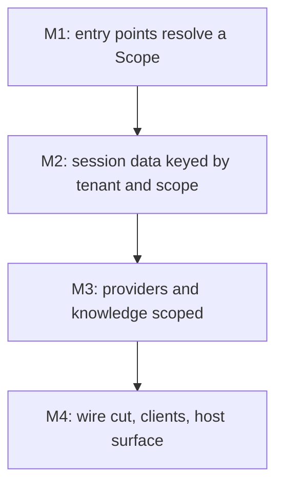

---
konstruct:
  docUuid: ce2e96c7-5165-4e82-aa91-3cd22c428c62
  docKind: plan
created: 2026-10-03T16:17:25.200Z
implemented: false
title: Replace workspace ID with tenant ID + scope ID
summary: "Hard-cut replacement of llmd's workspace_id with required tenant_id +
  optional scope_id: 4 milestones, 15 phases, from resolver seam through fresh
  schemas to the wire and client cut."
assistantSessionId: 0642a6b1-0505-4378-95c4-f6f10a7e4377
---
# Replace workspace ID with tenant ID + scope ID

llmd's single `workspace_id` becomes a two-level key: a required `tenant_id` and an optional `scope_id` (empty string \= tenant-wide). This is a hard cut with no compatibility layer; all databases are wiped. The design decisions are settled (see "Settled decisions" at the end). This plan sequences the work, names every touched surface, and records what the code survey found that the brief did not know.

## End state: nothing legacy survives

When the last milestone closes, llmd has no trace of the workspace ID as its own concept and no code that exists to bridge from it.

**Gone entirely**

* The `llmd-workspace-id` metadata key, the `X-Llmd-Workspace-Id` header and the `workspace_id` query parameter.
* Every `workspace_id` and `user_id` column in both databases, and every index or table name built on them.
* Every proto field, RPC, message and enum value named for a workspace.
* `workspaceId` and `workspaceHeaders` in the TypeScript client.
* `DefaultWorkspaceID`, `LLMD_DEFAULT_WORKSPACE_ID`, the `workspacescope` package and the old resolver functions.
* All legacy data-migration code in the main store and knowledge migrations `001` to `005`.
* The plan's own staging aids: the interim wire mapping and `Scope.LegacyWorkspaceID()`.
* Go, SQL and TypeScript identifiers, test helpers, file names and comments that call llmd's key a workspace.

**Deliberately kept** (they are not llmd's workspace ID)

* `ClientWorkspaceID` and `X-Client-Workspace-Id`: the host's own workspace concept (settled decision 1).
* `CursorCliLlmConfig.workspace` and the `cursorws` package: the Cursor CLI's workspace directory (D10).

**How this is enforced.** Three guard tests fail the build if a legacy name returns: one over the main-store schema (Phase 2.5), one over the knowledge schema (Phase 3.2) and one over the proto descriptors (Phase 4.2). The "Removal register" near the end lists every file and symbol that must not exist when the run finishes.

## What the survey found that changes the brief

These are facts about the tree at `ab04b5f9`. Each one alters scope or ordering.

1. **`packages/client-web` does not exist.** `packages/` holds `client`, `core`, `react` and four `cli-*` binary packages. `@llmd/client` ships both transports from one package (`./node` and `./web` exports). The web surface is `packages/client/src/web.ts`. The project rule that names `packages/client-web/src/index.ts` is stale and should be corrected separately.
2. **The hit count is about three times the estimate.** `internal/store` has 388 case-insensitive `workspace_id`/`WorkspaceID` hits (about 88 function declarations take a workspace ID), `internal/server` has 214, `internal/knowledge` 203 (including `user_id`), `packages` 108.
3. **Two tables do not include the workspace in their primary key today.** `llmd_session_events` is keyed `(session_id, seq)` and `llmd_session_turns` is keyed `(session_id, turn_seq)`. Two tenants using the same session ID would collide on insert. The required isolation test cannot pass without re-keying both.
4. **In-memory session state is keyed by session ID alone.** `sessionmanager.Manager.sessions` is `map[string]*SessionRuntime`; `EnsureLoaded` returns early for any caller once that session ID is loaded. `store.TurnRegister` (`Current`, `Bootstrap`, `Advance`) also takes only a session ID.
5. **Two aggregates read across every workspace.** `TurnMetadataRepo.GetAllWorkspaceTotals` and `ToolResultSidecarRepo.SumSavingsAllWorkspaces` back `GetWorkspaceTokenMetrics` when `all_workspaces` is set. Under tenancy they must stop at the tenant boundary.
6. **More proto surface than listed.** `llm.proto` also has the `GetWorkspaceTokenMetrics` RPC, its request/response messages and three `all_workspaces` fields. `mcpproxy.proto` also has `ToolProvider.workspaces = 9`.
7. **More places read the ID themselves.** Beyond the four listed: `internal/serve/session_events_ws.go` (the `workspace_id` query parameter), `internal/serve/debug_log.go` (reads the metadata key), `internal/server/invoke_tool.go` (rebuilds incoming metadata from a request field), `internal/toolprovider/server.go` (reads `ToolProviderHello.workspace_id`), `internal/server/mcpproxy_server.go` (reads `ListProxiedToolsRequest.workspace_id`), `internal/server/llamacpp_server.go` (reads `StartRequest.workspace_id`), and `llmdtest/harness.go`.
8. **`DefaultWorkspaceID` is already unreachable.** `dbWorkspaceID` returns `Unauthenticated` on empty metadata whenever a session manager exists, so the fallback in `llmdhost/host.go` never fires. There is nothing to reconcile: the field, the `LLMD_DEFAULT_WORKSPACE_ID` variable and the `llmdtest` option are deleted.
9. **llama.cpp managed state is a JSON file, not a table.** `internal/llamacpp/state.go` persists one app-global `managed-state.json` for one managed process. There are no rows to scope. See decision D4 below.
10. **Embedding providers are a second global provider family.** `llmd_embedding_providers` and its three child tables sit under the same "not scoped to a workspace" comment in `internal/store/models.go`. The public `embedprovider.Source` interface resolves them by provider ID alone.
11. **Existing swallowed errors on this path.** `internal/server/server.go` lines 2037 and 2103 (`uid, _ := s.dbWorkspaceID(ctx)`), `ctxWithCursorAgentRun` (returns silently on error), and `internal/toolexec/session_tools.go` `emitFrame` (`_, _ = events.AppendEvent(...)`). Each is fixed in the phase that touches it.
12. **Session hubs are not workspace-keyed.** Nothing under `internal/assistant/` mentions a workspace; hubs hang off the session runtime and inherit its keying. No change needed there.
13. **Stale comment in `internal/serverutil/import_direction_test.go`.** It describes an `embed_config.go` that no longer lives in that package. Today `serverutil` imports only gRPC, which is what allows `internal/store` to import it.

## Pushback: why the five-step sequence needs a different shape

The requested order is sound, but step 3 ("fresh schemas plus repo changes") is not executable as one step. About 88 store functions change signature, `internal/store` is imported by 52 files, and the SQL inside the store uses raw strings the compiler cannot check. Done at once, that is a rewrite of the store, the session manager, every handler and every test in a single uncheckable change.

The plan keeps the requested order and splits that step along two independent axes:

* **Type axis (compiler-checked).** `Scope` replaces the positional string layer by layer, top down: entry points, then managers, then store signatures. Each layer compiles and passes tests before the next starts.
* **Schema axis (test-checked).** Once every store function already takes a `Scope`, the column change is confined to the `internal/store` package and proven by that package's own tests.

Two staging aids make this possible. Both exist only while the work is in flight and both are removed before the run ends (see "End state"):

* **Interim wire mapping.** Until Milestone 4, the metadata key, headers and query parameter keep their current names and the resolver maps the existing `llmd-workspace-id` value to `Scope.TenantID` with an empty `ScopeID`. This preserves isolation and needs no default tenant. Phase 4.1 replaces the names outright, so there is never a moment when both old and new names are accepted.
* **One transitional method.** `Scope.LegacyWorkspaceID()` returns the string that code not yet converted still expects. It moves down one layer per phase, has no callers by the end of Milestone 3, and is deleted in Phase 4.1. Go's unused-variable error removes most uses automatically.

Size: 4 milestones, 15 phases. The largest single phase is 2.5 (the store schema change); it is bounded to one package with no exported signature changes.

## Decisions this plan had to make

The settled decisions left these open. Each has a default the phases assume; say so if any should change.

* **D1. Public package name.** `workspacescope/` is replaced by `tenantscope/`.
* **D2. Where `Scope` is defined.** In `internal/serverutil` as decided, aliased from `tenantscope`. `internal/store` imports `serverutil` for the type, so `serverutil` must never import `internal/store` or `internal/knowledge/store`. Phase 1.1 adds both to the forbidden list in `TestImportDirection`.
* **D3. Message fields that carry the caller's workspace are deleted, not renamed.** Five fields are removed outright, with no `reserved` entries left behind\:This is my reading of "get rid of workspace everywhere". Renaming them to `scope_id` would also leave nothing legacy; deletion is simpler because tenant and scope then travel only in metadata and the resolver has one input per surface. Two behaviours follow. `InvokeTool` used to let the request body override the metadata; now metadata is the only binding. A tool provider is no longer told the workspace on each invoke frame; it knows the scope from the stream it opened.
  * `ToolProviderHello.workspace_id`
  * `ToolExecutionInvoke.workspace_id`
  * `InvokeToolRequest.workspace_id`
  * `ListProxiedToolsRequest.workspace_id`
  * llama.cpp `StartRequest.workspace_id`
* **D3a. Fields that are not caller identity are renamed.** These are current features under a new name, not legacy: `ToolProvider.workspaces` (an allowlist) to `scopes`, `ListProxiedToolsResponse.workspace_tool_ids` to `scope_tool_ids`, the three `all_workspaces` flags to `all_scopes`, `GetWorkspaceTokenMetrics` to `GetScopeTokenMetrics`, `NEW_WORKSPACE_REQUIRED` to `NEW_SCOPE_REQUIRED`, and `LlamaStatus.workspace_id` (D4).
* **D4. llama.cpp.** Attribution only: `StartSpec` and `Status` carry a `Scope` taken from metadata, and `LlamaStatus` reports `tenant_id` and `scope_id`. The JSON state file stays app-global. Decision 5 lists llama.cpp state under config fall-through, but with one process and no rows that would be the redesign decision 7 defers.
* **D5. Embedding providers** get the same treatment as LLM providers (tenant and scope columns, config fall-through). `embedprovider.Source.Get` gains a `Scope` parameter; this is a public interface a host may implement.
* **D6. Tool provider streams** (`toolprovider.Hub`) stay exact-match on `(tenant, scope)`, which is today's behaviour.
* **D7. `all_scopes`** means every scope within the caller's tenant. No RPC reads across tenants.
* **D8. vec0 tables** swap `user_id, workspace_id` for `tenant_id, scope_id` and are otherwise unchanged. `partition_id` is not added to them: the overlay read path resolves partitions through `documents`, and changing that is a query redesign.
* **D9. Legacy knowledge tables are dropped.** The `knowledge_meta` singleton has no Go reader. The unsuffixed `document_embeddings` table appears only in the `vecEmbeddingTables` delete list in `query_vec.go`.
* **D10. Naming exceptions beyond `ClientWorkspaceID`.** `CursorCliLlmConfig.workspace`, `LlmProviderCursorCLIRow.Workspace`, `cursorws.CursorWorkspace` and `Registry.CursorWorkspaces` keep their names. They are the Cursor CLI's own workspace directory, and the first is a provider config message that decision 6 says not to change.
* **D11. `ClientWorkspaceID` source.** It is filled from the llmd workspace metadata today. After the cut it is filled from `Scope.ScopeID`.
* **D12. Missing tenant** stays `codes.Unauthenticated` on gRPC and keeps each HTTP surface's current status code.

## Target shapes

**Go API** (`internal/serverutil/scope.go`, re-exported by `tenantscope/`):

* `type Scope struct { TenantID, ScopeID string }` with `Validate()` (tenant required), `IsTenantWide()`, `String()` for logs.
* Inbound, one function per surface: `ScopeFromContext(ctx)` for gRPC metadata, `ScopeFromHTTPHeader(http.Header)`, `ScopeFromQuery(url.Values)`. No function takes a scope from a message body.
* Outbound: `Scope.OutgoingContext(ctx)`, `Scope.IncomingContext(ctx)`, `Scope.ApplyHTTPHeader(http.Header)`. Every caller that sends or fakes scope uses these, so no other file spells a key or header name.
* Wire names live in one file, `internal/serverutil/scope_wire.go`.
* During the run only: `Scope.LegacyWorkspaceID()`.

**Schema rule**, on every scoped table in both databases: `tenant_id TEXT NOT NULL`, `scope_id TEXT NOT NULL DEFAULT ''`, `tenant_id` leading every key and index that led with `workspace_id`. Index names follow: nothing keeps a `ws` or `workspace` infix.

Main store tables (all in `store.CoreModels`):

| Table                                                                                                                                                     | Change                                                                |
| --------------------------------------------------------------------------------------------------------------------------------------------------------- | --------------------------------------------------------------------- |
| `llmd_sessions`, `llmd_session_drafts`, `llmd_session_cache`, `llmd_turn_metadata`                                                                        | PK gains `tenant_id, scope_id` in place of `workspace_id`             |
| `llmd_session_events`, `llmd_session_turns`                                                                                                               | PK gains `tenant_id, scope_id` (neither includes the workspace today) |
| `llmd_chat_messages`, `llmd_tracked_document_versions`, `llmd_turn_decorations`, `llmd_turn_raw_chunks`, `llmd_tool_result_sidecar`, `llmd_session_queue` | lookup indexes lead with `tenant_id, scope_id`                        |
| `llmd_provider_session_sync`                                                                                                                              | PK column `user_id` becomes `tenant_id, scope_id`                     |
| `llmd_agent_profiles`                                                                                                                                     | unique index `(tenant_id, scope_id, name)`, exact match               |
| `llmd_llm_providers`, seven `llmd_llm_provider_*` child tables, `llmd_llm_provider_models`                                                                | PK gains `tenant_id, scope_id`; config fall-through                   |
| `llmd_embedding_providers`, three child tables                                                                                                            | same as LLM providers                                                 |

**Lookup helpers** in `internal/store`: `scoped(db, sc)` for exact match and `scopedOrTenantWide(db, sc)` for config tables. Every query goes through one of them.

## Conventions and gotchas for every phase

* **GORM drops zero values from struct conditions.** `Where(&SessionRow{TenantID: t, ScopeID: ""})` silently omits the scope predicate and returns every scope in the tenant. Always use string or map conditions. The same applies to `Updates(struct)`. This is the single most likely way to ship a leak.
* **Never NULL.** `scope_id` is `not null;default:''` in GORM tags and SQL.
* **Errors.** Every `err` branch logs with tenant, scope and session, or propagates. `Scope.String()` exists for this.
* **Two Go modules.** `cmd/llmd` has its own `go.mod`; `./...` from the root does not cover it. Any phase that changes a public package also runs `go build -C cmd/llmd ./...`.
* **Fix in the core library.** konstructd composes these services itself; nothing may depend on `cmd/llmd/main.go` for correctness.
* **Rename as you go.** When a phase touches a function, variable, test helper or comment that calls llmd's key a workspace, it renames it in the same change. Phase 4.5 catches what is left.
* **Removal within a phase versus at the end.** A phase proves that the old thing has no dependents; the files themselves are removed in the end-of-run sweep, tracked in the "Removal register". Two removals cannot wait and happen in-phase: the knowledge migration files (every embedded `.sql` file is executed) and regenerated proto code.
* **Baseline first.** I could not run commands in this session. Before Phase 1.1, record which of `go test ./...` and `go test -C cmd/llmd ./...` already fail, so later gates are not blamed for pre-existing breakage.

::konstruct{#m1-entry-points}

## Milestone 1 — Every entry point resolves a `Scope` through one resolver

After this milestone, tenant and scope are produced in exactly one place, which is the seam authentication will later attach to. The metadata key and the database are unchanged, and handlers no longer read a workspace from any message body. It is proven by the graph showing no caller of the old resolver functions outside the orphaned `workspacescope` package and the old functions' own test, and by the existing server, MCP and serve test suites passing with every test building its context from `Scope` helpers.

::konstruct{#phase-1-1}

### Phase 1.1 — `Scope` type and resolver

**Goal.** The type, the resolver and the public re-export exist and are tested. Nothing uses them yet.

**Size.** Small and additive: about 5 new files, no existing callers change. `internal/serverutil/workspace_scope.go` has 4 importing files and a depth-2 impact of 23 files (11 are tests); none are touched here.

**Work.**

* Add `internal/serverutil/scope.go` with the API under "Target shapes" and `internal/serverutil/scope_wire.go` holding the wire names. Under the interim mapping the resolver reads `llmd-workspace-id`, `X-Llmd-Workspace-Id` and the `workspace_id` query parameter into `TenantID`, leaving `ScopeID` empty.
* Add `internal/serverutil/scope_test.go`: missing tenant is `Unauthenticated`, values are trimmed, the outbound helpers round-trip through the inbound ones.
* Add `tenantscope/tenantscope.go`: `type Scope = serverutil.Scope` plus thin wrappers.
* Extend `TestImportDirection` to forbid `/internal/store` and `/internal/knowledge/store`, and correct its stale comment.

**Preconditions.** `internal/serverutil/workspace_scope.go` and `internal/serverutil/session_scope.go` do not import `internal/store` or `internal/knowledge/store`.

**Proof.** `ScopeFromContext`, `ScopeFromHTTPHeader` and `ScopeFromQuery` are defined in `internal/serverutil/scope.go`; `Scope` is defined in `tenantscope/tenantscope.go`. Commands: `go test ./internal/serverutil/...` and `go build ./...`.

::konstruct{#phase-1-2}

### Phase 1.2 — gRPC handlers onto the resolver

**Goal.** Every handler in `internal/server` obtains a `Scope` from the resolver and from nowhere else.

**Size.** Medium. About 46 resolution sites: `server.go` (22), `session_handlers.go` (10), `knowledge_server.go` (4), `attachment_handlers.go` (3), `agent_profile_handlers.go` (2), and one each in `session_queue_handlers.go`, `builtin_tools.go`, `subscribe_session_events.go`, `invoke_tool.go`, `mcpproxy_server.go`. Roughly 25 test files change one helper line each. Depends on 1.1.

**Work.**

* Add `(*LlmServer).scope(ctx) (serverutil.Scope, error)` in `internal/server/scope.go`. It has no `SessionRuntimes == nil` bypass; the tenant is always required.
* At each site: `sc, err := s.scope(ctx)`, then `uid := sc.LegacyWorkspaceID()` so the rest of the handler body is untouched. This is the transitional line later phases remove.
* `agent_profile_handlers.go`: keep the existing exception that the static profile tier answers without a scope; `profileWorkspaceID` becomes `profileScope`.
* `knowledge_server.go`: four `RequireWorkspaceID` calls become `serverutil.ScopeFromContext`.
* `invoke_tool.go` (D3): resolve with `s.scope(ctx)`. Stop reading `req.GetWorkspaceId()` and remove the metadata rebinding; the incoming context already carries the scope. Update the function's doc comment, which describes the body field as the sole binding.
* `mcpproxy_server.go` `ListProxiedTools` (D3): resolve from the context instead of `req.GetWorkspaceId()`.
* Fix the swallowed errors at `server.go` 2037 and 2103 and in `ctxWithCursorAgentRun`: log at warn with session ID.
* Tests: add a shared `testScope` (replacing `testDefaultWorkspaceID` and the per-file workspace constants) and replace every `metadata.AppendToOutgoingContext(ctx, metadataWorkspaceIDKey, …)` and literal `"llmd-workspace-id"` with `testScope.OutgoingContext(ctx)` or `IncomingContext`. Tests that call handlers on a server with no session manager and no metadata now need a scope.
* Tests that set `WorkspaceId:` on a request stop doing so and bind through the context: `invoke_tool_test.go`, `invoke_tool_refusal_test.go`, `agent_profile_handlers_test.go`, `disabled_tools_test.go`, `tool_policy_acceptance_test.go`, `mcpproxy_server_test.go`. The `invoke_tool_test.go` case that expects an error for a missing `workspace_id` becomes a missing-tenant case.

**Proof.** Nothing in `internal/server` calls `dbWorkspaceID`, `workspaceIDFromMetadata` or `RequireWorkspaceID`; `internal/server/workspace_scope.go` has no dependents within the package. `internal/server/invoke_tool.go` and `internal/server/mcpproxy_server.go` contain no call to `GetWorkspaceId`. Commands: `go test ./internal/server/...`.

::konstruct{#phase-1-3}

### Phase 1.3 — Side paths onto the resolver

**Goal.** No file outside `internal/serverutil` reads or writes a scope key, header or query parameter by name, and none reads a workspace from a message body.

**Size.** Medium, spread across small packages: `agentpid/agentpid.go` (9 dependents), `internal/mcpserver/server.go` (2 dependents, 9 test files), `internal/mcpstdio/bridge.go`, `internal/llm/claudecode/client.go` (7 dependents), `internal/serve/session_events_ws.go`, `internal/serve/debug_log.go`, `internal/toolprovider/server.go`, `internal/server/llamacpp_server.go`, `llmdtest/harness.go`, `examples/embed/main.go`. Depends on 1.2, because the MCP path and the gRPC path share session runtimes and their integration tests compare the two.

**Work.**

* `agentpid.Run`: replace `WorkspaceID string` with `Scope serverutil.Scope`. `ClientWorkspaceID` stays. Update the doc comment.
* `mcpserver.resolveAgentScope`: use `ScopeFromHTTPHeader(r.Header)`; return a `Scope`.
* `mcpstdio/bridge.go`: the session DTO carries the scope; `forwardRPC` calls `run.Scope.ApplyHTTPHeader`.
* `claudecode/client.go` `llmdMCPHTTPHeadersFromContext`: build headers through `Scope.ApplyHTTPHeader`.
* `session_events_ws.go`: `ScopeFromQuery(q)`; log lines print the scope.
* `debug_log.go`: use the resolver; drop the "server default workspace" wording.
* `toolprovider/server.go` (D3): resolve with `serverutil.ScopeFromContext(stream.Context())`. The hello frame's workspace field is no longer read; the `tool_provider_hello.user_id is required` check goes with it. Log lines print the scope.
* `llamacpp_server.go` (D3): `Start` resolves from the context instead of `req.GetWorkspaceId()`.
* `llmdtest/harness.go` and `examples/embed/main.go`: import `tenantscope` and build contexts with `Scope.OutgoingContext`.
* Tests in `internal/mcpserver`, `internal/serve`, `internal/toolprovider` and `internal/llm/claudecode` set and assert scope through the helpers and constants, never literals. `internal/mcpserver/workspace_binding_test.go` is renamed to `scope_binding_test.go`.

**Proof.** Nothing imports `workspacescope`. The only remaining callers of `serverutil.RequireWorkspaceID` and `serverutil.WorkspaceIDFromMetadata` are `workspacescope/workspacescope.go` and those functions' own test, `internal/serverutil/tenant_test.go`. `agentpid.Run` has no field named `WorkspaceID` referenced by any caller. `internal/toolprovider/server.go` contains no call to `GetWorkspaceId`. Commands: `go test ./internal/mcpserver/... ./internal/mcpstdio/... ./internal/serve/... ./internal/toolprovider/... ./agentpid/... ./llmdtest/...`, `go build ./...`, `go build -C cmd/llmd ./...`.

::konstruct{#m2-session-data}

## Milestone 2 — Session data is held and stored under `(tenant_id, scope_id)`

After this milestone the session manager, the tool path and every session-keyed table are keyed by tenant and scope, and the main database is a fresh schema with no legacy migration code. It is proven by a new store-level isolation test, a schema guard test, and the graph showing no store function that still takes a workspace ID string. Depends on Milestone 1.

::konstruct{#phase-2-1}

### Phase 2.1 — Session runtimes keyed by `Scope`

**Goal.** Two tenants can hold the same session ID in memory without seeing each other.

**Size.** Medium. `internal/sessionmanager/manager.go` has 13 dependents: `internal/server` (`server.go`, `session_handlers.go`, tests), `internal/mcpserver`, `internal/serve`, `llmdhost/host.go`.

**Work.**

* `Manager.sessions` is keyed by a struct of `Scope` and session ID. `SessionRuntime.WorkspaceID` becomes `Scope`. `ErrWrongWorkspace` becomes `ErrWrongScope`.
* `EnsureLoaded`, `Destroy`, `UpdateLlm`, `EnsureSession`, `RestoreSession` and every other lookup take a `Scope`. Audit each method that reads the map by bare session ID.
* `Options.NewSessionHistory` becomes `func(sc Scope, sessionID string) history.Store`. In `llmdhost/host.go` remove the `defaultWorkspaceID` fallback from the closure.
* `Destroy` currently returns `false` on a purge error with no trace; log it.
* Inside the manager, calls into the store pass `sc.LegacyWorkspaceID()` until Phase 2.3.

**Proof.** `ErrWrongScope` is defined in `internal/sessionmanager/manager.go`; nothing references `ErrWrongWorkspace`. A new test in `internal/sessionmanager` loads the same session ID under two tenants and asserts two distinct runtimes. Commands: `go test ./internal/sessionmanager/... ./internal/server/... ./internal/mcpserver/...`.

::konstruct{#phase-2-2}

### Phase 2.2 — Tool path and other in-memory carriers

**Goal.** Every in-memory structure that carried a workspace ID carries a `Scope`.

**Size.** Medium, many small files. `toolseam/handler.go` (7 dependents, public), `internal/toolexec` (`Invocation`, `session_tools.go`), `internal/toolsession/service.go`, `internal/toolprovider/hub.go` (5 dependents), `internal/tooldelegate/registry.go`, `internal/mcpproxy/registry.go`, `internal/server/mcpproxy_server.go`, `internal/llamacpp/service.go` (2 dependents), `llmdtools/install.go` (doc comment), `examples/embed/main.go`.

**Work.**

* `toolseam.Invocation.WorkspaceID` becomes `Scope tenantscope.Scope`. This is a public API change for hosts.
* `toolprovider.Hub.streams` is keyed by `Scope`; `HasProvider`, `Register`, `Invoke` take one. `Invoke` stops populating `ToolExecutionInvoke.WorkspaceId` (D3). Fix the stale "user id is required" message.
* `tooldelegate.Registry` stores and compares a `Scope`.
* `toolsession.ToolInvocationEnvelope` and `Service.ListDecorations` take a `Scope`.
* `mcpproxy`: `ServerConfig.Workspaces` becomes `Scopes`; `allowsWorkspace`, `AllReadyToolIDsForWorkspace`, `ToolIDsForAgent` are renamed and take a `Scope`, matching on `ScopeID`. The registry itself stays process-global (see "Known gaps").
* `llamacpp.StartSpec` and `Status` carry a `Scope` (D4).
* `toolexec/session_tools.go`: `requireSessionScope` returns a `Scope`; `emitFrame` logs the `AppendEvent` error instead of discarding it.

**Proof.** Nothing references `toolseam.Invocation.WorkspaceID` or `mcpproxy.ServerConfig.Workspaces`. `internal/toolprovider/hub.go` does not set `WorkspaceId` on any message. Commands: `go test ./toolseam/... ./internal/toolexec/... ./internal/toolprovider/... ./internal/tooldelegate/... ./internal/toolsession/... ./internal/mcpproxy/... ./internal/llamacpp/...`, `go build ./...`, `go build -C cmd/llmd ./...`.

::konstruct{#phase-2-3}

### Phase 2.3 — Store signatures take `Scope`: session-keyed repos

**Goal.** Signature change only. No SQL changes.

**Size.** Large by call-site count but purely mechanical and compiler-checked. Files: `session_repo.go`, `session_fork.go`, `session_tags.go`, `session_todos.go`, `history_gorm.go`, `chat_session.go`, `chat_cleanup.go`, `attachment_repo.go`, `session_draft_repo.go`, `session_queue_repo.go`, `session_cache_repo.go`, `session_event_repo.go`, plus their tests and every caller. Depends on 2.1 and 2.2.

**Work.** Each function replaces `workspaceID string` with `sc serverutil.Scope` and begins with `workspaceID := sc.LegacyWorkspaceID()`; the body is otherwise untouched. Callers pass `sc`. In handlers, the `uid := sc.LegacyWorkspaceID()` line from Phase 1.2 becomes unused wherever its last consumer was converted, and the compiler forces its removal.

**Proof.** `SessionRepo.GetSession`, `SessionEventRepo.AppendEvent`, `SessionQueueRepo.Enqueue`, `ChatAttachmentRepo.Upsert` and `store.NewHistory` take a `serverutil.Scope`. Commands: `go build ./...`, `go test ./internal/store/... ./internal/server/... ./internal/sessionmanager/... ./internal/serve/... ./internal/mcpserver/...`.

::konstruct{#phase-2-4}

### Phase 2.4 — Store signatures take `Scope`: turn bookkeeping and the rest

**Goal.** No exported function in `internal/store` takes a workspace ID string.

**Size.** Medium. Files: `turn_register.go`, `turn_metadata_repo.go`, `turn_raw_chunk_repo.go`, `turn_decoration_repo.go`, `tool_result_sidecar_repo.go`, `tracked_document_repo.go`, `tracked_document_assembly.go`, `provider_session_sync.go`, `agent_profile_repo.go`, and `internal/agentprofile/resolver.go` (the `DynamicStore` interface). Depends on 2.3.

**Work.**

* Same mechanical pattern as 2.3.
* `TurnRegister.Current`, `CurrentTurnID`, `Bootstrap`, `Advance` gain a `Scope`, and its in-memory map is keyed by scope and session. It has no workspace today, so this is a real signature addition at every call site.
* Aggregates are renamed and bounded: `GetWorkspaceTotals` to `GetScopeTotals(ctx, sc)`, `GetAllWorkspaceTotals` to `GetTenantTotals(ctx, tenantID)`, `SumSavingsWorkspace` to `SumSavingsScope`, `SumSavingsAllWorkspaces` to `SumSavingsTenant`. Until 2.5 the tenant variants filter on the single legacy column.
* `agentprofile.Resolver`: `useDynamic` is true when `TenantID` is non-empty.

**Proof.** Nothing calls `GetAllWorkspaceTotals` or `SumSavingsAllWorkspaces`. `TurnRegister.Advance` takes a `serverutil.Scope`. Commands: `go build ./...`, `go test ./internal/store/... ./internal/agentprofile/... ./internal/server/... ./internal/toolsession/...`.

::konstruct{#phase-2-5}

### Phase 2.5 — Fresh main-store schema

**Goal.** Every session-keyed table carries `tenant_id` and `scope_id`, and no legacy migration code runs.

**Size.** Large; this is the phase to watch. It touches only `internal/store` (57 files) and changes no exported signature, so no other package needs editing except tests that issue raw SQL (known: `internal/toolexec/session_tools_test.go` line 90). It cannot be split further because `ListSessions`, the message-usage queries, fork and purge join across these tables. Depends on 2.4.

**Work.**

* Models in `models.go`, `session_queue_models.go`, `agent_profile_models.go`, `provider_session_sync.go`: replace `WorkspaceID` with `TenantID` and `ScopeID` per the table under "Target shapes". Provider tables are left for Phase 3.1.
* Add `scoped(db, sc)` and route every query through it. Rewrite each raw `workspace_id = ?` predicate, each `ON CONFLICT` column list and each join condition.
* Each function drops its `workspaceID := sc.LegacyWorkspaceID()` line.
* `migrate_data.go`: remove steps 1 to 7 and 10 and their helpers (`migrateCollapseAgentIDToSessionID`, `migrateSessionFirstStorage`, `migrateSessionNativeCollapse`, `migrateProviderSessionSyncPKSchema`, `migrateChatSessionLookupIndex`, `migrateDropLegacyUserAgentColumns`, `migrateBackfillSessionGraphUsageTurnSeq`, `legacyChatSchemaPresent` and the merge helpers). Everything in `migrate_schema.go` becomes unreferenced; it and its test go on the removal register.
* Keep the four indexes the fresh schema needs, leading with `tenant_id, scope_id`: session list by `updated_at`, session list by `chat_surface, updated_at`, chat messages by `session_id, created_at`, session turns by `session_id, turn_seq`. Express them as GORM index tags, with names that carry no `ws` infix, so `runDataMigrations` has an empty step list. Keep the mechanism and `SchemaMigrationRow` for future use.
* `migrate.go`: remove the legacy table drop loop and its comment block.
* Rewrite `migrate_data_test.go` against the fresh schema.
* Add `internal/store/tenant_isolation_test.go` (see "Verification").
* Add `internal/store/schema_guard_test.go`: migrate a fresh database from `CoreModels`, walk every table, and fail on any column named `workspace_id`, `user_id` or `agent_id`-as-key, and on any index name containing `ws_` or `workspace`. This is the standing guard for the end state.

**Proof.** Nothing in `internal/store` calls `Scope.LegacyWorkspaceID`. Nothing calls `legacyChatSchemaPresent` or `providerSessionSyncHasAgentIDInPrimaryKey`. Commands: `go test ./internal/store/...` including the isolation and schema guard tests, then `go test ./internal/server/... ./internal/toolexec/... ./internal/mcpserver/... ./llmdtest/...`.

::konstruct{#m3-config-knowledge}

## Milestone 3 — Providers and knowledge are scoped; nothing uses the transitional method

After this milestone both databases follow the schema rule and the internals are complete. Only the wire names remain. It is proven by the graph showing no caller of `Scope.LegacyWorkspaceID`, by provider fall-through tests, and by a knowledge schema test against a real sqlite-vec build. Depends on Milestone 2.

::konstruct{#phase-3-1}

### Phase 3.1 — Provider tables and resolution

**Goal.** Providers are keyed `(tenant_id, scope_id, provider_id)` and resolve scoped-first, then tenant-wide.

**Size.** Medium. `internal/llm/providers/composite.go` has 14 dependents (mostly `internal/server` tests, `server.go`, `stateful_provider.go`, `llmdhost/host.go`). Store files: `llm_provider_repo.go`, `llm_provider_model_repo.go`, `embedding_provider_repo.go`, `embedding_provider_source.go`, `models.go`. Also `internal/llm/providers/register_proto.go`, `embedprovider/embedprovider.go` (5 dependents), `internal/knowledge/store/embed_config.go`.

**Work.**

* Models: the parent, all seven LLM child tables, `LlmProviderModelRow`, and the four embedding tables gain `TenantID` and `ScopeID` in the primary key. Rewrite the "Not scoped to a workspace" comment block.
* Repos take a `Scope`. Reads use `scopedOrTenantWide`: `Get` prefers the scoped row; `ListIDs` returns the union with the scoped row winning on an ID conflict. Writes and deletes are exact-scope and never fall through.
* `upsertLlmProvider` and the child-table cleanup loop filter by all three key columns.
* `Composite`: `Get`, `Backend`, `ListMerged`, `RefreshModels`, `DeleteModels`, `ListCatalog`, `InvalidateUserProvider` take a `Scope`. The cache is keyed by scope and provider ID. Any write drops every cached entry for that tenant and provider ID, because a new scoped row shadows a tenant-wide one. Rewrite the type's doc comment.
* Handlers for provider RPCs resolve a `Scope` (they needed no metadata before). `llmdtest/harness.go` provider registration attaches one.
* `embedprovider.Source.Get` gains a `Scope` parameter (D5).
* Provider config messages in `llm.proto` do not change, so the manual-sync rule does not trigger.

**Audit result: can a session reach another tenant's provider?** Sessions, agent profiles, turn metadata and provider-session sync reference providers by bare `provider_id` string with no foreign key. That is only cross-tenant today because providers are global. Once every resolution passes the session's own `Scope`, a session can reach only its scope's rows and its tenant's tenant-wide rows. The in-process `Registry` (`Composite.Global`) stays unscoped; it is nil in production.

**Proof.** `Composite.Get` and `LlmProviderRepo.Get` take a `serverutil.Scope`. New tests in `internal/store` and `internal/llm/providers`: a tenant-wide provider is visible from a scope; a scoped provider with the same ID wins; another tenant sees neither; deleting the scoped row re-exposes the tenant-wide one. Commands: `go test ./internal/store/... ./internal/llm/providers/... ./internal/server/... ./llmdtest/...`, `go build -C cmd/llmd ./...`.

::konstruct{#phase-3-2}

### Phase 3.2 — Knowledge database

**Goal.** One fresh knowledge schema keyed by tenant and scope, with no `user_id` and no `workspace_id`.

**Size.** Medium. `internal/knowledge/store` has 5 dependents (`internal/server/knowledge_server.go`, `internal/server/embed_config.go`, `llmdhost/host.go`, two integration tests). Files: `store.go`, `meta.go`, `partition.go`, `query_vec.go`, `errors.go`, `embed_config.go`, `embed_debug.go`, `internal/knowledge/embed/router.go`, and the migrations directory.

**Work.**

* Write one `001_init.sql` creating `knowledge_schema_migrations`, `documents`, `scope_knowledge_meta` (renamed from `workspace_knowledge_meta`), `knowledge_overlay_partitions`, `knowledge_overlay_owned`, and `document_embeddings_{384,512,768,1024,1536}`. Relational keys are `(tenant_id, scope_id, source_id, partition_id, …)`. `knowledge_meta` and the unsuffixed `document_embeddings` are not created (D9); remove the latter from `vecEmbeddingTables`.
* Delete `002_workspace_meta.sql`, `003_vec_512_1024.sql`, `004_vec_1536.sql` and `005_partitions.sql` in this phase. This cannot be deferred: `migrate.go` embeds and executes every `.sql` file in the directory.
* The store API takes a `Scope`. Remove the code that mirrors one ID into two placeholders, and delete the column-duplication note at the top of `store.go`.
* `readWorkspaceMeta` and `writeWorkspaceMeta` become `readScopeMeta` and `writeScopeMeta`. `IdlePartition` carries a `Scope`.
* `embed/router.go`: the backend cache key carries the scope.
* `knowledge_server.go` passes the resolved `Scope` straight through.

**Risk.** The note being deleted says the vec0 tables were never exercised against a live sqlite-vec build in the authoring environment. This phase must run where CGO and sqlite-vec work. If they do not, stop rather than proceed unproven.

**Proof.** Nothing calls `Scope.LegacyWorkspaceID` anywhere in the module. Primary gate: a new `cgo`-tagged test (no `integration` tag, no model download) that opens a fresh knowledge database and does two things. It inserts rows with synthetic vectors into `documents` and `document_embeddings_384` for two tenants with the same scope and source, and asserts each KNN query returns only its own tenant's chunks. It also walks every table and fails on any column named `workspace_id` or `user_id`, and on any table named `knowledge_meta`, `workspace_knowledge_meta` or `document_embeddings`. Secondary gate, which needs the embedding model already cached because a cold run downloads it: `go test -tags=integration -p 1 -count=1 ./internal/knowledge/store/...`. The drafter should confirm how `store_integration_test.go` opens the database and reuse it.

::konstruct{#m4-wire-cut}

## Milestone 4 — The wire, the clients and the host surface speak tenant + scope, and nothing legacy remains

After this milestone the "End state" section is true in full. It is proven by a wire-level two-tenant test in Go, a proto naming guard test, the TypeScript e2e suites, and the graph showing nothing depends on any entry in the removal register. Depends on Milestone 3; in particular the transitional method must have no callers, because `ScopeID` becomes non-empty here.

::konstruct{#phase-4-1}

### Phase 4.1 — Resolver reads the new keys

**Goal.** `llmd-tenant-id` is required and `llmd-scope-id` is optional on every surface. The old names are not accepted anywhere.

**Size.** Small. Because Milestone 1 routed everything through the resolver and its helpers, this is `internal/serverutil/scope_wire.go`, `scope.go`, their tests, and the stdio bridge DTO.

**Work.**

* Metadata `llmd-tenant-id`, `llmd-scope-id`; headers `X-Llmd-Tenant-Id`, `X-Llmd-Scope-Id`; query parameters `tenant_id`, `scope_id`. The interim mapping is replaced, not kept alongside.
* Delete `Scope.LegacyWorkspaceID` from `scope.go`.
* `ctxWithCursorAgentRun` fills `ClientWorkspaceID` from `sc.ScopeID` (D11).
* `mcpstdio/bridge.go` session DTO: `tenantId` and `scopeId` JSON fields.
* The startup log line in `cmd/llmd/main.go` names the new headers.
* Add `llmdtest/tenant_isolation_inprocess_test.go`: two tenants, same scope ID, same session ID, over real gRPC. Include a case that sends only the old `llmd-workspace-id` key and asserts `Unauthenticated`.

**Proof.** The new in-process test passes, including the old-key rejection case. Commands: `go test ./internal/serverutil/... ./internal/server/... ./internal/mcpserver/... ./internal/serve/... ./llmdtest/...`, `go build -C cmd/llmd ./...`.

::konstruct{#phase-4-2}

### Phase 4.2 — Proto cut and Go generated code

**Goal.** No proto field, enum value, message or RPC name says "workspace" for llmd's own concept.

**Size.** Small to medium. Four proto files and `gen/` regenerated. Go call sites are few because Phases 1.2, 1.3 and 2.2 already stopped reading and writing the deleted fields: what remains is `internal/server/llamacpp_server.go` (status response), `internal/server/mcpproxy_server.go` (response field and allowlist), the token-metrics handlers in `server.go`, `knowledge_server.go` (the remediation enum), and their tests.

**Work.**

* **Delete (D3), leaving no `reserved` entry:** `ToolProviderHello.workspace_id`, `ToolExecutionInvoke.workspace_id`, `InvokeToolRequest.workspace_id`, `ListProxiedToolsRequest.workspace_id`, llama.cpp `StartRequest.workspace_id`. Leave the field numbers as gaps; do not renumber.
* **Rename (D3a):**
  * `llm.proto`: `GetWorkspaceTokenMetrics` and its request and response messages to `GetScopeTokenMetrics`; the three `all_workspaces` fields to `all_scopes`.
  * `mcpproxy.proto`: `ListProxiedToolsResponse.workspace_tool_ids` to `scope_tool_ids`; `ToolProvider.workspaces` to `scopes`.
  * `llamacpp.proto`: `LlamaStatus.workspace_id` becomes `tenant_id` plus `scope_id`.
  * `knowledge.proto`: `NEW_WORKSPACE_REQUIRED` to `NEW_SCOPE_REQUIRED`; delete the existing `reserved "workspace_id"` entries.
* Rewrite comments that describe a workspace: the `ToolProviderHello` and `ListProxiedTools` comments, the "persisted globally" provider comment, the attachment and session-cache comments in `llm.proto`, and the `knowledge.proto` header.
* `CursorCliLlmConfig.workspace` stays (D10).
* Regenerate Go with `make generate` and fix the remaining call sites.
* Add `internal/server/proto_naming_test.go`: walk the descriptors of the four generated packages and fail on any message, field, enum value, service or method whose name contains "workspace", with a one-entry allowlist for `CursorCliLlmConfig.workspace`. This is the standing guard for the wire surface.

**Proof.** `GetScopeTokenMetrics` is defined in `gen/llmv1`. Nothing references `GetWorkspaceId`, `GetWorkspaceToolIds`, `GetWorkspaceTokenMetrics`, `GetAllWorkspaces` or `KnowledgeRemediation_NEW_WORKSPACE_REQUIRED`. Commands: `go build ./...`, `go test ./internal/server/... ./internal/toolprovider/... ./internal/mcpproxy/... ./internal/llamacpp/...` including the naming guard, `go build -C cmd/llmd ./...`.

::konstruct{#phase-4-3}

### Phase 4.3 — `@llmd/client`

**Goal.** The client sends tenant and scope and exposes no `workspaceId` option.

**Size.** Medium. Eight hand-written source files (`transport.ts`, `llm.ts`, `session.ts`, `sessionAttachments.ts`, `sessionHistory.ts`, `sessionList.ts`, `agentProfiles.ts`, `web.ts`) plus `index.ts`, the regenerated `src/gen`, and five unit test files under `packages/client/test`. None of the hand-written files sets a deleted body field, so D3 costs nothing here beyond regeneration.

**Work.**

* Regenerate with `npm --prefix packages/client run proto:gen`.
* `transport.ts`: `LLMD_TENANT_METADATA_KEY`, `LLMD_SCOPE_METADATA_KEY`, and `scopeHeaders({ tenantId, scopeId })` replace `LLMD_WORKSPACE_METADATA_KEY` and `workspaceHeaders`. An empty or missing `scopeId` sends no scope header.
* Every options type: `tenantId: string` (required) and `scopeId?: string`. There is no deprecated `workspaceId` alias.
* `web.ts`: the session-events WebSocket URL sets `tenant_id` and, when present, `scope_id`.
* Token-metrics helpers follow the RPC rename.
* The provider config mappers in `llm.ts` are unchanged.

**Preconditions.** `createWebSocketSessionEvents` is defined in `packages/client/src/web.ts`.

**Proof.** `scopeHeaders` is defined in `packages/client/src/transport.ts`; nothing imports `workspaceHeaders` or `LLMD_WORKSPACE_METADATA_KEY`. Commands: `npm --prefix packages/client run build:ts`, `npm --prefix packages/client test`.

::konstruct{#phase-4-4}

### Phase 4.4 — TypeScript e2e and `@llmd/react`

**Goal.** Both e2e suites pass against a real llmd binary using the new options.

**Size.** Medium by file count, small per file. `packages/client/e2e/harness.ts` has 19 dependents (6 client e2e tests, 13 React e2e tests). `packages/react/src` has no code hits, only doc comments in `useLlmdChatDriver.ts`.

**Work.**

* `harness.ts`: `E2eEnv` exposes `tenantId` and `scopeId`; headers come from `scopeHeaders`.
* Update each test file's option names, local variable names and generated ID prefixes (`e2e-ws-…`).
* Add a client e2e test: two tenants, same scope ID and session ID, neither reads the other's history; and a provider registered tenant-wide is usable from a scoped session.

**Proof.** Commands: `npm --prefix packages/client/e2e test` (this script builds the llmd binary first). For React, the equivalent script in `packages/react/e2e/package.json`; I did not read that file, so the drafter should confirm the script name.

::konstruct{#phase-4-5}

### Phase 4.5 — Host surface, docs and final naming pass

**Goal.** The public Go surface and the documentation match the new model, and every entry in the removal register has no dependents.

**Size.** Small for the host surface: `llmdhost/config.go` has 4 dependents (`cmd/llmd/main.go`, `examples/embed/main.go`, `llmdtest/harness.go`, `llmdtest/inprocess.go`). The naming pass is wide but shallow; earlier phases renamed as they went.

**Work.**

* Remove `llmdhost.Config.DefaultWorkspaceID`, the `LLMD_DEFAULT_WORKSPACE_ID` read in `cmd/llmd/main.go`, and `llmdtest`'s `DefaultWorkspaceID` option and `"llmdtest-default"` fallback. Update the `Config.Tools` comment to name `Invocation.Scope`.
* `llmdtest/harness.go`: `Env.NewSession(ctx, scope, sessionID)`; drop the `MetadataWorkspaceIDKey` re-export.
* `examples/embed/main.go`: show a host choosing a tenant and scope and resolving per-scope dependencies from `inv.Scope`.
* `docs/DEVELOPING.md`: the knowledge section's table, column and partition names.
* Final naming pass over Go, SQL and TypeScript: identifiers, test helpers, error strings, log messages and comments that still call llmd's key a workspace. Known leftovers to check: `ErrUserMismatch` and its message in `internal/tooldelegate/registry.go`, the provider log line in `cmd/llmd/main.go`, the header of `internal/llamacpp/state.go`, the `Composite` and `CoreModels` doc comments.

**Preconditions.** `Config.DefaultWorkspaceID` is referenced only by `llmdhost/host.go`, `cmd/llmd/main.go`, `examples/embed/main.go` and `llmdtest/inprocess.go`.

**Proof.** Nothing references `Config.DefaultWorkspaceID`. Nothing imports `workspacescope`. Nothing outside the removal register depends on any file listed in it. The three guard tests pass. Commands: `go build ./...`, `go test ./...`, `go build -C cmd/llmd ./...`, `go test -C cmd/llmd ./...`.

## Removal register

Everything below must not exist when the run finishes. Each entry names the phase after which it has no dependents; the end-of-run sweep removes it. The run is not complete while any entry remains on disk.

| What                                                                                                          | No dependents after        |
| ------------------------------------------------------------------------------------------------------------- | -------------------------- |
| `internal/server/workspace_scope.go` (`dbWorkspaceID` and aliases)                                            | 1.2                        |
| `workspacescope/` package                                                                                     | 1.3                        |
| `internal/serverutil/workspace_scope.go` and `internal/serverutil/tenant_test.go` (old resolver and its test) | 1.3                        |
| `internal/store/migrate_schema.go` and `migrate_schema_test.go`                                               | 2.5                        |
| Legacy step functions in `internal/store/migrate_data.go`                                                     | removed in 2.5             |
| Knowledge migrations `002` to `005`                                                                           | removed in 3.2             |
| `Scope.LegacyWorkspaceID`                                                                                     | removed in 4.1             |
| Interim wire mapping in `scope_wire.go`                                                                       | replaced in 4.1            |
| Generated `WorkspaceId` accessors in `gen/` and `packages/client/src/gen`                                     | regenerated in 4.2 and 4.3 |
| `workspaceHeaders`, `LLMD_WORKSPACE_METADATA_KEY`                                                             | removed in 4.3             |
| `Config.DefaultWorkspaceID`, `LLMD_DEFAULT_WORKSPACE_ID`                                                      | removed in 4.5             |

## What konstructd must change

konstructd is a separate repository that I have not seen, so this is a checklist to verify there, not a file list. It should integrate once Milestone 4 is complete, in one change. Nothing here has an old form that keeps working.

**Identity it sends**

* A fixed tenant ID on every llmd call. Suggested value: `konstruct`, defined once as a constant. Changing it later orphans all stored data.
* Its own workspace ID as the scope ID on session, knowledge, tool and agent-profile calls.
* Tenant only, with no scope, on provider registration and llama.cpp calls. That makes providers tenant-wide, which reproduces today's behaviour of one provider set shared by every workspace.

**Where it sends it: metadata only**

* gRPC metadata: `llmd-tenant-id`, `llmd-scope-id`. `llmd-workspace-id` is rejected as a missing tenant.
* HTTP to the MCP endpoint: `X-Llmd-Tenant-Id`, `X-Llmd-Scope-Id`. `X-Client-Workspace-Id` is unchanged.
* Session-events WebSocket URL: `tenant_id` and `scope_id`.
* No message body carries it any more. These calls must now have the metadata attached, where before the body field was enough:
  * opening the `ToolProviderService.Connect` stream (the hello frame no longer names a workspace);
  * `InvokeTool`;
  * `ListProxiedTools`;
  * llama.cpp `Start`.

**Messages that lost a field**

* `ToolProviderHello`, `InvokeToolRequest`, `ListProxiedToolsRequest`, llama.cpp `StartRequest`: stop setting `workspace_id`.
* `ToolExecutionInvoke` no longer carries a workspace. If konstructd's tool provider reads it to pick a workspace, it must instead use the scope of the stream the frame arrived on. Streams are matched exactly on `(tenant, scope)`, so that is one stream per workspace.

**Messages and RPCs that were renamed**

* `GetWorkspaceTokenMetrics` is `GetScopeTokenMetrics`; `all_workspaces` is `all_scopes` and stops at the tenant.
* `ListProxiedToolsResponse.scope_tool_ids`, `ToolProvider.scopes`.
* `LlamaStatus.tenant_id` and `scope_id`.
* `KnowledgeRemediation.NEW_SCOPE_REQUIRED`.

**Go API it links**

* `workspacescope` becomes `tenantscope`.
* Tool registrars read `inv.Scope.ScopeID` (and `inv.Scope.TenantID`) instead of `inv.WorkspaceID`.
* `llmdhost.Config.DefaultWorkspaceID` no longer exists; stop setting it.
* If it supplies `Config.EmbeddingProviders`, its `embedprovider.Source.Get` gains a `Scope` parameter.
* If it constructs `agentpid.Run`, the `WorkspaceID` field is now `Scope`.
* Because it composes llmd's services with its own startup sequence, check that sequence for any place that reads the old metadata key or header itself.

**TypeScript**

* `@llmd/client` options: `tenantId` (required) and `scopeId` (optional) replace `workspaceId`. `scopeHeaders` replaces `workspaceHeaders`.

**Data**

* Delete both SQLite files (main and knowledge) and re-register providers.

## Verification

| What                                                         | Where                                                                    | Phase              |
| ------------------------------------------------------------ | ------------------------------------------------------------------------ | ------------------ |
| Go tests, root module                                        | targeted `go test` per phase; full `go test ./...` at each milestone end | all                |
| Go build and tests, `cmd/llmd`                               | `go build -C cmd/llmd ./...`, `go test -C cmd/llmd ./...`                | 1.3, 2.2, 3.1, 4.x |
| Store isolation                                              | `internal/store/tenant_isolation_test.go`                                | 2.5                |
| Main-store schema guard                                      | `internal/store/schema_guard_test.go`                                    | 2.5                |
| Provider fall-through                                        | `internal/store`, `internal/llm/providers`                               | 3.1                |
| Knowledge isolation and schema guard against real sqlite-vec | new `cgo` test, then the `cgo && integration` suite                      | 3.2                |
| Wire isolation over gRPC, old key rejected                   | `llmdtest/tenant_isolation_inprocess_test.go`                            | 4.1                |
| Proto naming guard                                           | `internal/server/proto_naming_test.go`                                   | 4.2                |
| TypeScript unit                                              | `npm --prefix packages/client test`                                      | 4.3                |
| TypeScript e2e                                               | `packages/client/e2e`, `packages/react/e2e`                              | 4.4                |

**The store isolation test** uses tenants A and B with the same scope ID and the same session ID, and asserts for every session-keyed table (session row, messages, events, turns, draft, queue, cache, attachments, tracked documents, sidecar, turn metadata, decorations, provider-session sync):

* A's reads return none of B's rows, and the reverse.
* `TurnRegister` issues turn 1 independently in each tenant.
* Purging or forking A's session leaves B's untouched.
* Scope is exact: `Scope{A, ""}` does not return `Scope{A, "s1"}` rows, and the reverse. This is the case that catches the GORM zero-value pitfall.
* Agent profiles: the same name is allowed in A and B, and rejected twice within one `(tenant, scope)` including the tenant-wide scope. This is the case that proves empty string rather than NULL.
* Tenant totals for A exclude B.

## Known gaps left open

* **`mcpproxy` registry is process-global.** Proxied MCP server configs are visible to every tenant, filtered only by a scope allowlist. Making it tenant-aware is a separate change.
* **llama.cpp state is app-global** (D4). Any tenant can see and change the managed model.
* **The tenant is consumer-asserted.** Nothing verifies it until authentication lands at the resolver.
* **Postgres.** The main store has Postgres-specific code in `migrate_schema.go` that Phase 2.5 orphans. I did not check whether a Postgres test path exists; the fresh schema is GORM-generated and should hold, but it is unverified here.

## Settled decisions (reference)

1. "Scope" replaces "workspace" everywhere in llmd, except `ClientWorkspaceID` and `X-Client-Workspace-Id`.
2. `llmd-tenant-id` required, `llmd-scope-id` optional; HTTP `X-Llmd-Tenant-Id`, `X-Llmd-Scope-Id`. No server-side default tenant.
3. Tenant is consumer-asserted for now; resolved in exactly one place.
4. `tenant_id TEXT NOT NULL`, `scope_id TEXT NOT NULL DEFAULT ''`; empty means tenant-wide; never NULL; `tenant_id` leads every key and index.
5. Data tables are exact-match. Config tables return scoped plus tenant-wide rows, scoped winning. Agent profiles stay exact-match.
6. Provider tables gain tenant and scope from request metadata, not from fields on the provider config messages.
7. llama.cpp: keys only, no redesign.
8. Knowledge DB: remove `user_id`; one fresh schema replaces migrations `001` to `005`.
9. `Scope{TenantID, ScopeID}` with a single resolver in `internal/serverutil`, re-exported publicly, passed as a struct through repos and managers.
10. When the work is done, nothing legacy related to workspace IDs is supported or left in the tree.